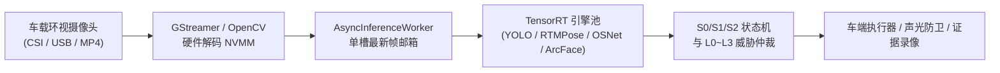

# NVIDIA Jetson Orin 车载露营守卫系统部署与 TensorRT Engine 运行全指南

本指南详细说明如何在 **NVIDIA Jetson Orin** 系列嵌入式计算平台（包括 **Orin Nano 4GB/8GB**、**Orin NX 8GB/16GB**、**AGX Orin 32GB/64GB**）上，以纯 **TensorRT Engine (.engine)** 硬件加速模式运行露营哨兵守卫系统。

---

## 目录
1. [系统架构与加速优势](#1-系统架构与加速优势)
2. [硬件与系统环境要求](#2-硬件与系统环境要求)
3. [Jetson 系统环境一键配置](#3-jetson-系统环境一键配置)
4. [一键批量编译 TensorRT Engine 模型](#4-一键批量编译-tensorrt-engine-模型)
5. [运行方式与指令示例](#5-运行方式与指令示例)
6. [五大核心模型规格与 Engine 说明](#6-五大核心模型规格与-engine-说明)
7. [Jetson Orin 性能极致调优建议](#7-jetson-orin-性能极致调优建议)

---

## 1. 系统架构与加速优势

在车载边缘端部署时，传统 ONNXRuntime CPU 推理会面临 CPU 占用率过高、帧率低（约 3~5 FPS）且发热严重的问题。

本项目针对 Jetson Orin 深度优化，实现了 **全链路 TensorRT Engine (.engine) 原生推理**：
* **显存零拷贝（Zero-Copy）**：利用 Jetson Orin 的 CPU 与 Ampere 架构 GPU 共享统一物理内存（Unified LPDDR5），消除主机内存与显存之间重复搬运开销。
* **FP16 半精度加速**：启用 Orin Tensor Cores 硬件单元，目标检测与姿态估计推理速度提升 4~8 倍。
* **流式异步解耦（Async Streaming）**：视频/摄像头主线程保持 **30+ FPS** 满速平滑渲染，后台 AI 工作线程以最大硬件算力（约 15~25 FPS）持续输出研判结果，杜绝界面卡顿与丢帧。



---

## 2. 硬件与系统环境要求

| 规格项 | 推荐配置 | 最低配置 |
| :--- | :--- | :--- |
| **计算平台** | Jetson Orin NX (16GB) / AGX Orin | Jetson Orin Nano (4GB/8GB) |
| **操作系统** | JetPack 5.1.2 (L4T 35.4) 或 JetPack 6.0+ (L4T 36.x) | JetPack 5.0+ |
| **TensorRT** | TensorRT 8.6.x 或 TensorRT 10.x | TensorRT 8.5.x |
| **CUDA / cuDNN** | CUDA 11.4 / 12.2，cuDNN 8.6+ | 系统自带 |
| **Python** | Python 3.8 / 3.10 / 3.12 | Python 3.8+ |

---

## 3. Jetson 系统环境一键配置

### 3.1 检查系统与 TensorRT 状态
登录 Jetson Orin 终端，执行检查：
```bash
# 1. 验证 TensorRT Python 绑定
python3 -c "import tensorrt as trt; print('TensorRT Version:', trt.__version__)"

# 2. 验证 PyTorch 与 CUDA 支持
python3 -c "import torch; print('CUDA Available:', torch.cuda.is_available(), 'Device:', torch.cuda.get_device_name(0))"

# 3. 验证 trtexec 命令行编译器
/usr/src/tensorrt/bin/trtexec --version
```

### 3.2 开启 Orin 满血性能模式
在运行守卫系统前，建议锁定 Orin 的最高 CPU/GPU 时钟频率（避免动态调频导致单帧延迟波动）：
```bash
# 设置为 MAXN 满血功耗模式 (以 Orin Nano/NX 为例)
sudo nvpmodel -m 0

# 锁定 GPU/CPU 最大工作频率与风扇全速
sudo jetson_clocks
```

---

## 4. 一键批量编译 TensorRT Engine 模型

项目中提供了专用的自动编译工具 [`batch_convert_trt.py`](file:///c:/workplace/code/guard/batch_convert_trt.py)，可扫描 `models/` 目录并将所有 ONNX 模型自动使用 `trtexec` 编译为适用于当前 Orin 硬件架构的 `.engine` 文件：

```bash
# 进入项目根目录
cd guard

# 一键编译所有模型为 FP16 TensorRT Engine 并生成测速评测报告
python3 batch_convert_trt.py models --precision fp16 --workspace 2048
```

编译完成后，将在 `models/` 对应子目录下生成对应的 `.engine` 镜像：
* `models/yolo/yolo11n.engine` / `yolo11s.engine`
* `models/pose/rtmpose-s.engine`
* `models/reid/osnet_x0_25.engine`
* `models/insightface/det_500m.engine`
* `models/insightface/w600k_mbf.engine`
* 生成报告：`models/benchmark_report.md`（包含每款模型的 FPS、Mean Latency、GPU Compute Time 及显存开销）。

---

## 5. 运行方式与指令示例

### 方式一：Jetson Orin 专属一键启动控制台 (推荐)
使用项目新增的 [`run_jetson_guard.py`](file:///c:/workplace/code/guard/run_jetson_guard.py)：

#### 1. 配合车载鱼眼录像 MP4 进行离线实测
```bash
python3 run_jetson_guard.py --video "C:\Users\chanceyu\Downloads\开门碰撞1.mp4" --camera-id 1
```

#### 2. 直接连接车载 CSI 硬件鱼眼摄像头 (硬件加速直通)
```bash
# 使用第 0 路 CSI 鱼眼摄像头
python3 run_jetson_guard.py --csi 0 --camera-id 1
```

#### 3. 连接车载 USB 摄像头 (/dev/video0)
```bash
python3 run_jetson_guard.py --usb 0 --camera-id 1
```

#### 4. 车载无头静默守护进程模式 (后台常驻，不弹图形窗口)
```bash
python3 run_jetson_guard.py --video "sample.mp4" --headless
```

---

### 方式二：使用通用视频评估流水线启动
在 [`test_video_pipeline.py`](file:///c:/workplace/code/guard/test_video_pipeline.py) 中追加 `--use-trt` 参数即可自动切换为 TensorRT 引擎模式：

```bash
python3 test_video_pipeline.py \
    --video "C:\Users\chanceyu\Downloads\开门碰撞1.mp4" \
    --camera-id 1 \
    --use-trt \
    --realtime
```
* **系统行为**：系统会自动在 `models/yolo/` 与 `models/pose/` 中寻找优先级最高的 `.engine` 镜像；若已生成，控制台会输出 `[TensorRT Engine]` 挂载标签并全速运行。

---

### 方式三：Python 代码中直接调用 Engine
在自己的业务脚本中，只需要在初始化 `CampingGuardEngine` 时指定 `use_tensorrt=True`：

```python
from camping_guard.engine import CampingGuardEngine
from camping_guard.perception.detector import TRTObjectDetector
from camping_guard.perception.pose_estimator import RTMPoseEstimator

# 1. 显式加载 TensorRT 检测器与姿态模型 (或由 engine 自动发现)
detector = TRTObjectDetector("models/yolo/yolo11n.engine", conf_threshold=0.25)
pose_estimator = RTMPoseEstimator("models/pose/rtmpose-s.engine", use_trt=True)

# 2. 启动引擎 (自动开启全部 5 个模型的 TensorRT 加速)
engine = CampingGuardEngine(
    detector=detector,
    pose_estimator=pose_estimator,
    use_tensorrt=True
)
engine.activate()

# 3. 每帧处理
# result = engine.process_tick({1: frame})
```

---

## 6. 无显示器（Headless）远程环境运行与实时效果查看

Jetson Orin 作为车载边缘设备或远程 Linux 服务器部署时，通常没有物理显示器，直接调用 `cv2.imshow` 会因为没有 X11 图形环境而报错或静默挂起。

针对这一实际工程场景，系统内建了 4 种无头远程效果查看方案：

### 🌟 方案一：Web 浏览器实时流看板（默认开启，强烈推荐）
无需安装任何额外客户端软件，只需本地电脑/手机/平板的浏览器即可访问。

1. **在 Jetson Orin 上启动程序**：
```bash
python3 run_jetson_guard.py --video "sample.mp4" --camera-id 1
# 或者使用通用测试工具并加上 --web 参数
python3 test_video_pipeline.py --video "sample.mp4" --camera-id 1 --use-trt --web
```
2. **终端会输出就绪访问地址**：
```
============================================================================
 🌐 【网页实时看板已就绪】(无显示器设备专属):
    👉 请在本地浏览器 (电脑/手机/平板) 访问: http://192.168.1.120:8080
============================================================================
```
3. **在你的电脑/手机浏览器打开** `http://<Jetson-IP>:8080`：
* **实时视频**：MJPEG 硬件低延迟流（<100ms），带有车周防区网格、距离线、目标跟踪框与骨骼点；
* **车载遥测状态**：实时显示当前帧率 (FPS)、端到端 AI 耗时 (ms)、S0~S2 状态机状态、L0~L3 威胁等级徽章；
* **远程交互按钮**：网页端提供 `[⏯ 暂停/继续]`、`[⏭ 单帧步进]`、`[📑 切换看板视图]`、`[🔄 重新开始]`，以及 `[🚪 CAN 拉门注入]`、`[💥 IMU 震动冲击注入]` 等实车信号仿真测试按钮。

> 💡 **提示**：若 Jetson Orin 位于云服务器或 NAT 内网，可以使用 SSH 端口转发直接本地穿透：
> ```bash
> ssh -L 8080:localhost:8080 username@<jetson-ip>
> ```
> 然后在本地浏览器打开 `http://127.0.0.1:8080` 即可！

---

### 方案二：直接保存为分析 MP4 视频并回传查看
在离线跑完一段实测视频或采集数据后，将带标注图层的完整视频保存为 MP4：

```bash
# 运行并保存结果视频到 output.mp4 (自动在无头模式下安静运行)
python3 run_jetson_guard.py --video "开门碰撞1.mp4" --camera-id 1 --output "result.mp4" --headless
```
运行结束后，在本地电脑上下载该视频即可查看完整逐帧标注：
```bash
# 在你自己的笔记本电脑终端执行 (从 Jetson 下载到本地)
scp username@<jetson-ip>:~/guard/result.mp4 ./
```

---

### 方案三：RTSP / GStreamer 硬件编码推流 (适用于 VLC / NVR)
如果需要长周期无人值守或接入车载流媒体中控，可以利用 Orin 的 NVENC 硬件芯片将渲染画面编码为 H.264 推流：
```bash
# 使用 GStreamer 硬件编码管道推流至局域网 UDP/RTSP
python3 run_jetson_guard.py --video "sample.mp4" --output "appsrc ! video/x-raw, format=BGR ! queue ! videoconvert ! video/x-raw, format=BGRx ! nvvidconv ! video/x-raw(memory:NVMM) ! nvv4l2h264enc bitrate=4000000 ! rtph264pay ! udpsink host=192.168.1.100 port=5000"
```
电脑端打开 VLC 播放器输入 `rtp://@:5000` 即可观看硬件加速高清流。

---

### 方案四：VS Code Remote - SSH 原生端口转发与文件预览
如果您平时使用 **VS Code** 的 `Remote - SSH` 插件连接 Jetson Orin：
1. 在 VS Code 底部面板点击 **Ports（端口）**；
2. 添加端口 `8080`（Forwarded Port）；
3. 打开内置浏览器或直接点击小地球图标，VS Code 会自动安全代理并在编辑器内直接显示实时控制面板！

---

## 7. 五大核心模型规格与 Engine 说明

| 模型功能 | 默认权重路径 | 典型输入尺寸 | Engine 编译命令参考 |
| :--- | :--- | :--- | :--- |
| **YOLO 目标检测** | `models/yolo/yolo11n.engine` | `1x3x640x640` | `trtexec --onnx=yolo11n.onnx --saveEngine=yolo11n.engine --fp16` |
| **RTMPose 姿态** | `models/pose/rtmpose-s.engine` | `1x3x256x192` | `trtexec --onnx=rtmpose-s.onnx --saveEngine=rtmpose-s.engine --fp16` |
| **OSNet 人员重识别** | `models/reid/osnet_x0_25.engine` | `16x3x256x128` | `trtexec --onnx=osnet_x0_25.onnx --saveEngine=osnet_x0_25.engine --fp16` |
| **SCRFD 人脸定位** | `models/insightface/det_500m.engine` | `1x3x640x640` (动态) | `trtexec --onnx=det_500m.onnx --saveEngine=det_500m.engine --minShapes=input.1:1x3x320x320 --optShapes=input.1:1x3x640x640 --maxShapes=input.1:1x3x640x640 --fp16` |
| **ArcFace 特征比对** | `models/insightface/w600k_mbf.engine`| `1x3x112x112` | `trtexec --onnx=w600k_mbf.onnx --saveEngine=w600k_mbf.engine --fp16` |

---

## 7. Jetson Orin 性能极致调优建议

1. **统一显存调度优化**：
   * 在使用 PyTorch 处理输入图像时，尽量将预处理张量保持在 GPU 上连续存储（`.contiguous().cuda()`），避免频繁的 CPU-GPU 往返复制。
2. **硬件解码加速（Hardware NVDEC）**：
   * 若使用车载 RTSP 或本地高清 MP4，建议在 OpenCV 中启用 GStreamer 管道（例如 `rtspsrc ! rtph264depay ! nvv4l2decoder ! nvvidconv ! video/x-raw, format=BGR ! appsink`），将 CPU 解码负载降至 0%。
3. **分层状态机能效阶梯（S0 $\rightarrow$ S1 $\rightarrow$ S2）**：
   * 系统在 **S0 待机** 下只跑低频运动检测（约 2 FPS），整机功耗仅约 5~7W；
   * 仅在发现目标进入防区时唤醒 **S1 (YOLO11n)**；
   * 仅在目标靠近车身核心区（Zone 2）时按需拉起 **S2 (RTMPose-s / FaceID)**，极大延长电动汽车露营外放电续航时间。
