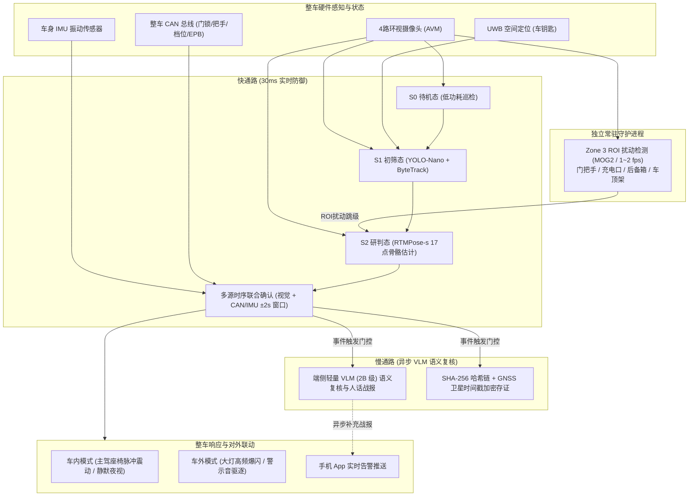

# 智能汽车露营守卫算法系统 (Smart Camping Guard System)

[](https://www.python.org/)
[](#目标车载硬件与功耗策略-高通-8155)
[](#自动化单元与回归测试)
[](#版权与说明)

> **基准技术方案**：[camping_guard_algorithm_flow_revised_1.md](file:///C:/workplace/code/guard/camping_guard_algorithm_flow_revised_1.md)  
> **工程落地计划**：[camping_guard_implementation_plan.md](file:///C:/Users/chanceyu/.gemini/antigravity/brain/8846ffae-d5df-46ac-b66b-e04eea6cb340/camping_guard_implementation_plan.md)  
> **目标部署硬件**：高通骁龙 8155（SA8155P）智能座舱域控制器

---

## 📖 项目简介

智能汽车露营守卫算法系统是一套专为汽车野外露营、驻车就寝与无人看护场景设计的端到端全时安全防御感知中间件。

系统在**整车极低功耗待机（$\le 3\sim 5\text{ W}$）**的物理约束下，结合 4 路环视鱼眼摄像头（AVM）、车身 IMU 振动传感器、整车 CAN 门锁微动开关与 UWB 钥匙空间定位，实现对**拉门撬锁、贴窗窥探、暴力踢踹、外挂装备盗窃、猛兽冲刺、失控火灾以及黑客中继攻击（Relay Attack）**的高灵敏秒级防御与证据级存证。

---

## 🌟 核心设计原则与架构亮点



1. **快慢双通路分流架构（Fast/Slow Path Decoupling）**：
   - **快通路（30ms 毫秒级防御）**：轻量 YOLO-Nano + RTMPose-s 骨骼点 + CAN/IMU 硬件信号联合确认，以 15~30 fps 毫秒级完成报警、座椅震动与声光驱逐；
   - **慢通路（0.8~1.5s 异步复核）**：端侧 2B-VLM 异步多模态复核，恪守“只升不降（有接触信号决不降级）”铁律，生成 $\le 50$ 字结构化事件战报，**绝不阻塞前端实时帧率**。
2. **Zone 3 常驻固定 ROI 扰动守护（阶段 0.5）**：
   - 独立于主状态机常驻运行（1~2 fps），对门把手、充电口、后备箱锁等标定部件做 MOG2 背景扰动监视；
   - 具备**全局大面积环境异常过滤**机制（暴雨/起雾/狂风不误报），一旦确认局部触车，直跳 S2。
3. **时序联合确认（Joint Confirmation）**：
   - 视觉手部动作/踢踹姿态与整车 CAN 门把手拉动/IMU 震动峰值在 **$\pm 2.0\text{ s}$ 严苛时间窗口内融合**才升至 L3 紧急高危，彻底杜绝单纯隔空假动作误报。
4. **安全闭环与中继攻击防御（Anti-Relay-Attack）**：
   - 车辆收到解锁信号必须经现场 UWB 空间钥匙强校验（$\le 1.5\text{ m}$）；
   - 若检测到解锁但无现场 UWB 匹配，**坚决不退出守卫并强制升级 L3 紧急报警与持续录像**。

---

## 🎯 防区划分与威胁响应矩阵

### 1. 四级同心防区物理定义

```
   [ Zone 0 远场: 距车身 > 6.0 m ]                     ── 忽略 (保持 S0 待机)
  ────────────────────────────────────────────────────────────────────────
   [ Zone 1 一级警戒区: 3.0 ~ 6.0 m (±0.3m 迟滞) ]      ── S1 初筛 (YOLO-Nano + ByteTrack 轨迹与白名单)
  ────────────────────────────────────────────────────────────────────────
   [ Zone 2 二级警戒区: 0.5 ~ 3.0 m (±0.3m 迟滞) ]      ── S2 研判 (RTMPose-s 骨骼点 + 动作分类 + 滞留计时)
  ────────────────────────────────────────────────────────────────────────
   [ Zone 3 接触区: 0 ~ 0.5 m (固定标定 ROI 监视) ]     ── 敏感构件常驻监视 (触车/撬锁秒级直跳 S2)
                     ┌───────────┐
                     │   车 体   │
                     └───────────┘
```

### 2. 四级威胁与模式联动矩阵

| 威胁等级 | 风险定性 | 判定核心条件 | 车内模式（车主在车内就寝） | 车外模式（车内无人） |
| :--- | :--- | :--- | :--- | :--- |
| **L0 安全** | 无威胁/白名单 | 无移动目标 / 命中 UWB/人脸白名单 / 有人看管稳定营火 | 静默审计日志 | 静默审计日志 |
| **L1 提示** | 常规经过 | 陌生人在 Zone 1 滞留 $\le 30\text{s}$ 或 Zone 2 滞留 $\le 10\text{s}$ | 后台轨迹记录，不打扰车主 | 后台轨迹记录，不打扰车主 |
| **L2 预警** | 徘徊/窥探/ROI扰动 | Zone 1 滞留 $> 30\text{s}$、Zone 2 滞留 $> 10\text{s}$、贴窗窥探（前倾 $>25^\circ$ 持续 $\ge 3\text{s}$）、单路相机遮挡 $>5\text{s}$、纯视觉拉门 | 1. 锁存前 10s 后 20s 加密录像；<br>2. 手机 App 静默通知；<br>3. 座舱屏最低亮度微光夜视（可选） | 1. 锁存前 10s 后 20s 加密录像；<br>2. 手机 App 常规图文通知；<br>3. 车底照地灯低照度补光 |
| **L3 紧急** | 侵入破坏/触车/猛兽 | 拉门撬锁+CAN信号、踢踹+IMU峰值、猛兽冲刺（3帧确认）、双路相机遮挡、非法中继攻击解锁 | 1. **主驾座椅电机脉冲震动唤醒车主**；<br>2. 手机 App 最高优先级强震动警报；<br>3. 完整录像加盖哈希链防篡改时间戳；<br>4. 30秒无响应自动启动车外声光驱逐 | 1. **日行灯/大灯高频爆闪 3 次**；<br>2. 车外扬声器播放低音警示音；<br>3. 手机 App 立即弹出紧急弹窗；<br>4. 完整录像加盖哈希链防篡改时间戳 |
| **火情 L3** | 失控蔓延 | 火源面积持续扩大且进入 Zone 2（$<3\text{m}$）或浓烟逼近 | 主驾座椅震动 + App 强提醒 + 车内撤离提示音（**禁用驱逐**） | 手机 App 强提醒 + 车外持续声光撤离提醒（**禁用驱逐**） |

---

## 🛠️ 代码工程结构

```
c:\workplace\code\guard/
├── camping_guard/                         # 露营守卫算法核心包
│   ├── types.py                           # 核心枚举(GuardState, ThreatLevel)与数据类
│   ├── config.py                          # 防区距离、迟滞阈值、时间窗口、默认参数
│   ├── state_machine.py                   # S0/S1/S2 主状态机引擎、中继攻击防御校验器
│   ├── zone3_daemon.py                    # 阶段0.5：Zone 3 常驻固定 ROI 守护进程 (MOG2)
│   ├── engine.py                          # 端到端核心协同调度引擎 (CampingGuardEngine)
│   ├── tools/                             # 辅助工具包
│   │   ├── __init__.py
│   │   └── roi_calibrator.py              # Zone 3 ROI 交互式多边形标定与几何校验工具
│   ├── perception/                        # 感知层模块
│   │   ├── distance.py                    # 单目接地测距、±0.3m 迟滞状态机、径向速度计算
│   │   ├── whitelist.py                   # 双通道白名单(UWB空间对齐 + FaceID)与超时解绑
│   │   ├── tracker.py                     # 目标轨迹管理与累计滞留计时器(离开10s内累计)
│   │   ├── bytetrack.py                   # 车载轻量 ByteTrack 追踪引擎 (低置信度遮挡恢复)
│   │   ├── detector.py                    # S1 初筛检测引擎抽象 (ONNXRuntime + Synthetic)
│   │   ├── pose_estimator.py              # S2 RTMPose-s 姿态估计引擎 (256x192, SimCC 1D 解码)
│   │   └── video_source.py                # 4 路 AVM 环视视频流分发服务 (S0/S1/S2 动态降频)
│   ├── analysis/                          # 深度研判与多模态融合层
│   │   ├── pose_action.py                 # 基于 17 骨骼点的时序动作分类器 (贴窗/拉把手/踢踹)
│   │   ├── fusion.py                      # 多源时序联合确认 (视觉动作与 CAN/IMU ±2s 毫秒级融合)
│   │   └── fire_monitor.py                # 露营火情专用研判 (稳定有人看管 vs 失控蔓延 L3)
│   ├── review/                            # 慢通路服务
│   │   └── vlm_reviewer.py                # 异步 VLM 复核 (门控唤醒、只升不降铁律、<=50字总结)
│   ├── evidence/                          # 存证服务
│   │   └── recorder.py                    # 环形视频缓冲(-10s至+20s锁存)、SHA-256防篡改哈希链
│   └── vehicle/                           # 整车接口与执行器联动
│       ├── mock_bus.py                    # 虚拟 CAN 总线 / IMU 震动 / UWB 钥匙发生器
│       └── actuator.py                    # 响应动作矩阵执行器 (车内座椅震动 vs 车外大灯爆闪)
├── roi_config.json                        # 车身敏感部件 (门把手/充电口/车顶架) 标定坐标持久化配置
├── scripts/
│   └── export_to_8155_snpe.py             # 高通 8155 (SA8155P) SNPE/QNN 模型量化与校准生成工具
├── tests/                                 # 自动化回归测试套件
│   ├── test_camping_guard.py              # Phase 1 核心功能测试 (7 项)
│   ├── test_phase2.py                     # Phase 2 感知管线与 ByteTrack 测试 (6 项)
│   ├── test_phase3.py                     # Phase 3 姿态估计与联合确认测试 (6 项)
│   └── test_phase4.py                     # Phase 4 VLM 异步复核与防篡改存证测试 (6 项)
└── run_simulation.py                      # 交互式端到端可视化全流程仿真控制台
```

---

## 🚀 快速上手与运行

### 1. 环境准备
推荐使用 Python 3.10+，核心依赖库：
```powershell
pip install opencv-python numpy onnxruntime pytest
```

### 2. 运行自动化单元与回归测试
项目内置了完善的 **25 项全量自动化测试**，覆盖状态机流转、中继攻击拦截、Zone 3 扰动、ByteTrack、RTMPose 几何时序、传感器联合确认、端侧 VLM 异步队列、只升不降安全沙箱以及不可篡改 SHA-256 哈希链：

```powershell
pytest -v tests
```

**测试输出示例**：
```text
tests/test_camping_guard.py::test_system_activation PASSED               [  4%]
tests/test_camping_guard.py::test_relay_attack_defense PASSED            [  8%]
tests/test_camping_guard.py::test_normal_exit_with_uwb PASSED            [ 12%]
tests/test_camping_guard.py::test_zone3_resident_daemon PASSED           [ 16%]
tests/test_camping_guard.py::test_multimodal_joint_confirmation PASSED   [ 20%]
tests/test_camping_guard.py::test_campfire_monitoring PASSED             [ 24%]
tests/test_camping_guard.py::test_camera_occlusion_degradation PASSED    [ 28%]
tests/test_phase2.py::test_roi_calibrator_io_and_validation PASSED       [ 32%]
tests/test_phase2.py::test_bytetrack_association_and_occlusion_recovery PASSED [ 36%]
tests/test_phase2.py::test_bytetrack_integrated_with_engine PASSED       [ 40%]
tests/test_phase2.py::test_detector_interface_and_synthetic PASSED       [ 44%]
tests/test_phase2.py::test_onnx_detector_helpers PASSED                  [ 48%]
tests/test_phase2.py::test_multicamera_stream_manager PASSED             [ 52%]
tests/test_phase3.py::test_rtmpose_crop_warp_and_simcc_decoding PASSED   [ 56%]
tests/test_phase3.py::test_keypoint_driven_window_peeking PASSED         [ 60%]
tests/test_phase3.py::test_keypoint_driven_door_handle_pull_and_l3_fusion PASSED [ 64%]
tests/test_phase3.py::test_keypoint_driven_kicking_and_imu_fusion PASSED [ 68%]
tests/test_phase3.py::test_beast_sprint_multi_frame_l3_confirmation PASSED [ 72%]
tests/test_phase3.py::test_engine_top_down_rtmpose_pipeline PASSED       [ 76%]
tests/test_phase4.py::test_vlm_gating_conditions PASSED                  [ 80%]
tests/test_phase4.py::test_vlm_async_worker_queue_non_blocking PASSED    [ 84%]
tests/test_phase4.py::test_strict_anti_downgrade_rule PASSED             [ 88%]
tests/test_phase4.py::test_pure_visual_l2_false_alarm_downgrade PASSED   [ 92%]
tests/test_phase4.py::test_evidence_recorder_clip_assembly_and_video_export PASSED [ 96%]
tests/test_phase4.py::test_tamper_evident_sha256_hash_chain PASSED       [100%]
============================= 25 passed in 1.32s ==============================
```

---

### 3. 运行交互式仿真控制台

启动带有 HUD 仪表盘、防区透视多边形、敏感部件 ROI、17 骨骼关键点连线渲染、VLM 慢通路战报与防篡改存证链的可视化仿真程序：

```powershell
python run_simulation.py
```

#### 键盘交互测试快捷键指南：
- **`[1]`**：注入陌生人进入 **Zone 1** 外围经过 $\rightarrow$ 触发 **L1 提示**（静默记录）；
- **`[2]`**：注入目标在 **Zone 2** 核心区徘徊 $\rightarrow$ 滞留超 10 秒自动升级 **L2 预警**；
- **`[3]`**：模拟目标贴车并尝试抓握拉动门把手 $\rightarrow$ 触发纯视觉 **L2 预警**；
- **`[h]`**：**【CAN 硬件注入】** 注入门把手被机械拉动信号 $\rightarrow$ **时序联合确认秒升 L3 紧急高危**；
- **`[k]`**：**【IMU 硬件注入】** 注入车身冲击震动峰值 $\rightarrow$ 踢踹/碰撞联合确认升 **L3 紧急**；
- **`[l]`**：**【安全对抗】** 注入车辆解锁信号（测试车主钥匙不在现场时的**中继攻击防御拦截**，守卫不退出且升 L3）；
- **`[u]`**：切换车主 UWB 钥匙在线/远离（测试车主白名单与中继攻击鉴权）；
- **`[f]`**：注入露营营火（测试稳定受控火源与蔓延 $<3\text{ m}$ 的紧急撤离告警）；
- **`[o]`**：模拟单路/双路相机泥泞遮挡故障与系统降级；
- **`[8]`**：**【VLM 语义测试】** 注入纯视觉环境假阳性（树叶/光影） $\rightarrow$ 经 VLM 语义复核安全降级至 **L1 提示** 并锁定录像；
- **`[9]`**：**【防篡改审计】** 一键校验车端不可篡改 **SHA-256 哈希链** 完整性；
- **`[m]`**：切换 **车内模式**（座椅脉冲震动）与 **车外模式**（大灯 3 次爆闪 + 车外扬声器）；
- **`[c]`**：清空场景所有目标并重置假阳性状态；
- **`[q]` 或 `ESC`**：安全退出仿真。

---

### 4. 工程化解耦：单 JSON 文件注入整车标定参数 (vehicle_calib.json)

系统全面解耦了车型参数、多路相机外参、Zone 3 车身敏感 ROI 与安全防区阈值。**无需修改任何 Python 逻辑或传入散落的参数，只需传入单个 JSON 标定文件即可切换全车配置**：

```json
{
  "vehicle_info": {
    "model_name": "SUV_Camping_Guard_Edition",
    "vin": "VIN_8155_2026_TEST_001",
    "wheelbase_m": 2.95,
    "width_m": 1.98,
    "length_m": 4.98
  },
  "cameras": {
    "0": { "camera_id": 0, "name": "front_fisheye", "camera_height_m": 0.85, "camera_pitch_deg": -12.0, "fov_deg": 190.0, "resolution": [640, 480] },
    "1": { "camera_id": 1, "name": "left_mirror_fisheye", "camera_height_m": 1.20, "camera_pitch_deg": -15.0, "fov_deg": 190.0, "resolution": [640, 480] },
    "2": { "camera_id": 2, "name": "right_mirror_fisheye", "camera_height_m": 1.20, "camera_pitch_deg": -15.0, "fov_deg": 190.0, "resolution": [640, 480] },
    "3": { "camera_id": 3, "name": "rear_fisheye", "camera_height_m": 0.95, "camera_pitch_deg": -20.0, "fov_deg": 190.0, "resolution": [640, 480] }
  },
  "zone3_rois": [
    { "roi_id": "handle_fl", "name": "左前门把手", "camera_id": 1, "polygon": [[160, 260], [220, 260], [220, 310], [160, 310]], "threshold_ratio": 0.10, "confirm_frames": 2 },
    { "roi_id": "trunk_lock", "name": "后备箱开关与锁扣", "camera_id": 3, "polygon": [[270, 280], [370, 280], [370, 350], [270, 350]], "threshold_ratio": 0.12, "confirm_frames": 2 }
  ],
  "thresholds": {
    "zone_far_dist_m": 6.0,
    "zone_outer_dist_m": 3.0,
    "zone_inner_dist_m": 0.5,
    "door_pull_min_sec": 1.5,
    "window_peek_min_sec": 3.0
  }
}
```

---

### 5. 针对实车单路 MP4 鱼眼视频进行算法评估 (test_video_pipeline.py)

如果你录制了实车环视或台架拍摄的单路鱼眼相机 MP4 视频（例如左侧后视镜鱼眼）：

```powershell
# 1. 基础回放测试 (自动注入 vehicle_calib.json 标定参数)
python test_video_pipeline.py --video your_fisheye_video.mp4 --config vehicle_calib.json --camera-id 1

# 2. 挂载 YOLO11n 目标检测与 RTMPose 姿态模型 (全量算法链)
python test_video_pipeline.py --video your_fisheye_video.mp4 --config vehicle_calib.json --camera-id 1 --detector yolo11n.onnx --pose rtmpose-s.onnx

# 3. 无头测试 (后台批处理并导出渲染分析视频)
python test_video_pipeline.py --video your_fisheye_video.mp4 --config vehicle_calib.json --detector yolo11n.onnx --pose rtmpose-s.onnx --headless --output eval_result.mp4
```

> 💡 **自带样例视频**：项目内已自动生成包含“外部目标接近并拉门”的合成鱼眼视频样例 `sample_fisheye_left.mp4`，你可以直接输入 `python test_video_pipeline.py --video sample_fisheye_left.mp4` 开箱即用验证效果！

---

### 6. 针对单张静态图片进行算法诊断 (test_single_image.py)

若你需要针对单张鱼眼照片（`.jpg` / `.png`）排查目标识别、多通道接地测距、Zone 3 ROI 碰撞与 17 骨骼点分析：

```powershell
# 基础运行 (从 vehicle_calib.json 自动匹配 Camera 1 的外参和 ROI 标定)
python test_single_image.py --image your_photo.jpg --config vehicle_calib.json --camera-id 1

# 导出带 HUD 仪表盘与骨骼点连线的高清诊断分析图
python test_single_image.py --image your_photo.jpg --config vehicle_calib.json --output analysis_result.jpg --headless
```


---

## ⚡ 目标车载硬件与功耗策略 (高通 8155)

针对座舱域控制器 **Qualcomm SA8155P** 的量产部署优化：

1. **算力核心分工**：
   - **Hexagon 690 DSP / HTA (NPU)**：运行 INT8 定点化 `YOLO-Nano`（~4ms）与 `RTMPose-s`（~2.2ms），单帧 DSP 占用率 $< 20\%$，杜绝夜间主机发热；
   - **Kryo Silver 小核（Cortex-A55 @ 1.8GHz）**：绑定运行 S0 常驻 Zone 3 微动守护，**大核（A76）深度休眠**，实现整夜待机功耗 $\le 3\text{ W}$。
2. **高通 SNPE / QNN 量化配置**：
   运行内置脚本，可一键生成 8155 DSP 专用的 RAW 二进制量化校准集与编译命令：
   ```powershell
   python scripts/export_to_8155_snpe.py
   ```

---

## 🗺️ 项目实施路线 (Roadmap)

- [x] **Phase 1: 算法架构与仿真闭环原型**（状态机、中继攻击防御、Zone 3 守护、时序联合确认）
- [x] **Phase 2: 感知初筛与追踪引擎开发**（`roi_config.json` 标定工具、ByteTrack 追踪、ONNX 检测抽象、4 路流频控）
- [x] **Phase 3: S2 姿态关键点与多模态联合确认**（RTMPose-s 仿射裁剪与 SimCC 解码、前倾角贴窗、把手接触、猛兽冲刺）
- [x] **Phase 4: 异步 VLM 复核与防篡改存证流水线**（端侧 2B-VLM 提示词工程、SHA-256 哈希链落盘、人话战报）
- [ ] **Phase 5: 整车系统闭环与高通 8155 域控集成**（QNX/Android VHAL 对接、SOME/IP 服务封装、C++ 推理重构）
- [ ] **Phase 6: 全工况恶劣环境路测与量产验收**（暴雨风噪抑制、红蓝攻防对抗、实车功耗基线标定）

---

## 📄 版权与说明

本项目代码与文档均遵循内部汽车技术方案保密规范开发，未经授权不得外传。
