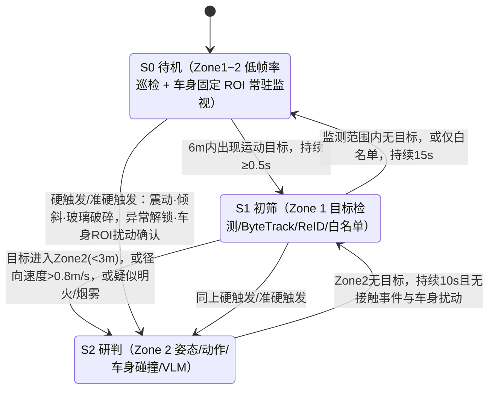

# 智能汽车露营守卫算法流程

---

## 一、系统激活与结束条件

### 1. 激活条件（以下 3 项同时满足才开启）
1. 车辆处于驻车档（P 档）且电子手刹（EPB）已拉起；
2. 中控屏或手机 App 上的"露营守卫"开关置为开启；
3. 所有车门、后备箱已关闭并上锁（未关闭时提示车主，不静默启动）。

### 2. 结束机制

**正常退出（需验证后才终止）**
- 踩下刹车踏板并切出 P 档：直接退出（车内有人操作）；
- 车门解锁（物理钥匙、App、蓝牙钥匙）：进入"**车主验证**"，而不是直接终止：
  - UWB 钥匙在车旁 1.5 米内且鉴权有效 → 正常退出，事件日志保留；
  - 解锁来源无法与 UWB 位置匹配（钥匙不在场或位置异常）→ 判定为**疑似中继攻击/越权解锁**，守卫**不退出**，触发 L3 告警并持续录像。

**故障与降级（不静默退出，均需告警）**

| 故障情形 | 处理方式 |
| :--- | :--- |
| 单路相机被遮挡/失效，持续超过 5 秒 | **L2 告警**（遮挡可能是作案手段），其余相机 + 震动/门状态继续守卫，视野盲区在 App 中提示 |
| 两路及以上相机被遮挡，或遮挡同时出现震动/接触信号 | **L3 告警**，全力保留剩余传感器数据，持续到车主确认 |
| 多路相机 ROI 同时大面积扰动（镜头起雾/剧烈震动/暴雨等环境或设备异常） | 判定为环境/设备异常，不按接触事件处理，转入本表故障流程并告警 |
| 存储空间不足 | 通知车主；L2/L3 事件录像已锁定不覆盖，普通缓存循环覆盖 |
| NPU/算法异常 | 降级到"S0 + 震动/门状态"的最小守卫，并上报异常 |

---

## 二、警戒区空间划分与车身固定 ROI

以车辆外轮廓为基准，向外划分同心防区。Zone 0~2 的距离为**地面接地点到车身外轮廓**的物理水平距离。取消原 0~0.5 m 孤立的 Zone 3 距离分档切分（因想要触车必然已处于 Zone 2 范围内），**将 Zone 2 统一扩展为 0 ~ 3.0 m 直达车身外轮廓**；同时在车身表面预先标定**敏感部件与车身防碰撞固定 ROI（感兴趣区域）**，构建“人类意图姿态估计 + 车身物理碰撞运动检测”双轨研判体系。

```
   [ Zone 0 远场: 距车身 6.0 m 以外 ]                                ── 不处理（忽略）
  ────────────────────────────────────────────────────────────────────────────
   [ Zone 1 一级警戒区: 3.0 ~ 6.0 m ]                                ── 外围初筛与白名单
  ────────────────────────────────────────────────────────────────────────────
   [ Zone 2 核心研判区: 0 ~ 3.0 m 直达车身 ]                         ── 核心意图/行为/碰撞研判
     ├─ [ 人类意图研判轨 ]: RTMPose 17 骨骼点 ∩ 敏感部件/车窗 ROI 几何拓扑判定
     └─ [ 物理破坏研判轨 ]: MOG2 车身防碰撞 ROI (门板/侧围/车顶) 运动扰动检测
                     ┌───────────┐
                     │   车 体   │ (表面覆盖门把手/充电口/行李架/门板等固定 ROI)
                     └───────────┘
```

**工程约束**
- 单目测距在远端误差较大：Zone 1/2 的距离按**接地点 + 标定后的鱼眼几何逆投影（IPM）**估计，判定使用**距离分档**，边界加**迟滞（±0.3 m）**，避免目标在边界抖动造成状态反复切换。
- 6 米外的目标检测与测距不稳定，Zone 0 内的目标不参与任何等级判定。
- **去除孤立 Zone 3，保留车身固定 ROI**：相机与车身结构相对固定，门把手、后备箱锁、油箱盖/充电口、车顶行李架等**敏感部件 ROI**，以及车侧门板、前后保险杠等**车身防碰撞监视区 ROI**在各路相机画面中的像素坐标可预先标定，定义为固定 ROI，作为低功耗常驻监视、物理碰撞告警和接触判定的基础（详见阶段 0.5）。
- **极近距离托底铁律（Floor Rule）**：任何陌生实体（人员、邻车或未知障碍物）地面距离进入 ≤ 0.5 m 内，系统输出等级**绝对不得降级为 L0 安全**，必须维持至少 L1 提示（伴随逼近速度或滞留时直接维持 L2 预警），彻底根除近车目标因视野截断而误判为无威胁的缺陷。
- **双轨研判分工**：
  1. **人员接触与破坏**：由 RTMPose 17 骨骼关节点驱动（手腕 ∩ 把手多边形、上身前倾 ∩ 车窗、脚踝冲量踢踹钣金）；
  2. **非人类外物破坏与碰撞**：临近车门碰撞（邻车开门摆动撞击）、原本在 Zone 2 内静止的物体突发破坏（如狂风折断树木砸击车身、帐篷杆倒塌、落石、自行车倒覆等）无法通过姿态估计判定，必须依赖**车身固定 ROI 区域的背景减除（MOG2）运动扰动检测**触发，联动录像锁存与 VLM 语义复核。
- 车主 UWB 钥匙在车周时，S0 不静默：仍由 S1 快速完成白名单过滤（S1 开销小于漏检的代价）。

| 防区 / 区域 | 距离/定义 | 主要算法 | 核心功能 |
| :--- | :--- | :--- | :--- |
| **Zone 0 远场** | > 6.0 m | 无 | 忽略 |
| **Zone 1 一级警戒区** | 3.0 ~ 6.0 m | 低功耗 NPU 目标检测（YOLO 系）+ ByteTrack | 目标框、类别、接地测距、径向速度、FaceID/ReID 会话初筛、记录轨迹 |
| **Zone 2 核心研判区** | 0 ~ 3.0 m（直达车身） | 主 NPU 姿态估计（RTMPose）+ VLM 多模态视频理解 | 人体姿态/意图识别（窥探、逼近、冲刺、拉门）、滞留判定、极近距离（≤0.5m）高警惕托底 |
| **车身固定 ROI（常驻）** | 车身敏感部件（把手/锁扣/充电口/行李架）及车门门板/车侧防碰撞区 | 背景建模/光流的 ROI 运动扰动检测（OpenCV MOG2，常驻低功耗）+ 触发后姿态/VLM 联合复核 | 触车、撬锁、踢踹、装备盗窃以及**邻车开门碰撞、树木倒塌砸车等非姿态类外物物理破坏**的低功耗常驻监视与事件触发，联动自动录像与 VLM 复核 |
---

## 三、四级威胁分级体系

根据**"目标类别 + 所处防区 + 行为/滞留特征 + 接触信号"**综合判定，命中任一即触发，取最高等级。

| 等级 | 定义 | 触发条件 | 系统动作 |
| :--- | :--- | :--- | :--- |
| **L0 安全** | 无威胁 / 已知免扰 | 1. 防区内无移动实体；<br>2. 目标命中白名单（UWB 或人脸）；<br>3. 判定为飞虫、草木风噪、雨雪、已建模的营地物品（帐篷/天幕/椅子摆动）；<br>4. "篝火/炉具"火源稳定有人看管 | 静默日志 |
| **L1 提示** | 陌生实体常规经过 | 1. 陌生人员在 Zone 1 且累计滞留 ≤ 30 秒；<br>2. 陌生人员进入 Zone 2 且累计滞留 ≤ 10 秒；<br>3. 无害小动物（鸟类/松鼠等）在Zone1内徘徊；<br>4. 陌生车辆在 Zone 1 通过；<br>5. **极近距离托底**：陌生实体进入 ≤ 0.5 m 极近范围内，系统输出等级绝不降为 L0，维持至少 L1 提示 | 启动检测与追踪，记录轨迹与日志；不打扰车主 |
| **L2 预警** | 可疑徘徊、窥探、疑似接触、环境风险 | 1. 陌生人员在 Zone 1 累计滞留 > 30 秒，或在 Zone 2 累计滞留 > 10 秒；<br>2. **贴窗窥探**：头部位于车窗区域 0.5 m 内且朝向车窗，持续 ≥ 3 秒；<br>3. 视觉判定的疑似拉门/撬锁/踢踹/装备盗窃（无接触信号）；<br>4. 大型猛兽在 Zone 1/2 徘徊；<br>5. 快速径向逼近（人：> 1.5 m/s 且指向车身进入 Zone 2）；<br>6. 无人看管的火源（Zone 1/2 稳定火焰，无人在场 > 5 分钟）；<br>7. 单路相机被遮挡 > 5 秒；<br>8. **车身固定 ROI（敏感部件或门侧/保险杠防碰撞区）运动扰动多帧确认**（如邻车开门碰擦、树木倒下倾砸车身等，姿态判定或 VLM 复核尚未完成/未达到破坏动作标准，见阶段 0.5） | 事件录像加密锁定（事前 10 秒至事后 20 秒）；按模式响应（见第五章） |
| **L3 紧急** | 侵入破坏、触车行窃、猛兽冲刺、火灾、防篡改 | 1. **拉门撬锁**：视觉手部持续停留在把手区域 + 把手/锁被拉动、异常解锁请求或震动信号；<br>2. **踢踹/碰撞破坏**：视觉踢踹动作或车身防碰撞 ROI 运动扰动 + 车身震动峰值（IMU）；<br>3. **装备盗窃**：手部持续停留在行李箱/自行车架/充电口区域 ≥ 2 秒 + 车身状态变化或 VLM 复核确认；<br>4. **猛兽冲刺**：大型猛兽径向逼近速度 > 1.2 m/s，连续 3 帧确认且进入 Zone 2；<br>5. **火情蔓延**：火焰面积持续增大且距车 < 3 m，或浓烟逼近车体；<br>6. 玻璃破碎特征、车辆倾斜/被抬升；<br>7. 两路及以上相机被遮挡。 | 事件录像加盖防篡改时间戳落盘；手机强提醒；按模式响应（见第五章） |

**累计滞留规则**：基于 PersonSessionManager 与 OSNet 512 维深度外观特征（ReID）持续维护身份画像。同一目标（跨相机传递、短暂遮挡或短暂离开防区后 10 秒内重入）的外观特征与会话池匹配关联，其停留时间、进入次数与轨迹状态**持续累计**而不是清零，防止遮挡换 ID 或"来回试探"绕过滞留阈值。

**速度规则**：所有速度判定使用**径向分量**（朝车身方向），切向经过（如路过慢跑者）不计入；速度超阈值仅用于**唤醒 S2 和加权研判**，不单独升到 L3（猛兽冲刺除外，需类别 + 连续帧确认）。

---

## 四、运行状态与流转

### 1. 状态定义

| 状态 | 关联防区 | 激活硬件 | 运行算法 |
| :--- | :--- | :--- | :--- |
| **S0 待机** | 车周监测范围（Zone 1~2，Zone 0 忽略） | 低功耗相机流（低帧率/低分辨率）+ IMU + 车身状态信号 | OpenCV背景建模运动检测（含风噪/营地物品建模）；车身固定 ROI 扰动检测（常驻，见阶段 0.5）；环形缓冲低码率录像 |
| **S1 初筛** | Zone 1 | 低功耗 NPU + 四路相机（正常帧率） | 目标检测（人/动物/车辆/火焰烟雾）、ByteTrack、单目测距、径向速度、OSNet-ReID会话池管理、UWB/人脸白名单；车身固定 ROI 扰动检测（常驻）；环形缓冲录像 |
| **S2 研判** | Zone 2（0~3.0 m 直达车身） | 主 NPU + 四路相机 | 姿态估计（RTMPose）、动作时序分类、接触信号融合、车身固定 ROI 扰动检测（常驻）、VLM 事后视频理解；环形缓冲录像 |

> **说明**：车身固定 ROI（敏感部件及车门/侧围碰撞区）的扰动检测计算量很小，作为**独立于主状态机的常驻通路**，在 S0/S1/S2 任一阶段都持续运行，不随主状态回落而关闭。一旦确认扰动，直接把主状态机拉到 S2（见下文状态流转）。

### 2. 状态流转



| 流转 | 条件 | 说明 |
| :--- | :--- | :--- |
| S0 → S1 | 运动检测在 Zone 1~2 内持续 ≥ 0.5 秒确认 | 防单帧噪声 |
| S0/S1 → S2（硬触发/准硬触发） | 任一硬触发（震动/倾斜/玻璃破碎/异常解锁/门把手异常）或 **车身固定 ROI 扰动多帧确认** | 跳级唤醒，同时启动事件录像与 VLM 复核，不等待常规防区分流 |
| S1 → S2（常规升级） | 目标进入 Zone 2（<3 m，含迟滞）；或径向逼近速度 > 0.8 m/s；或疑似明火/烟雾 | |
| S2 → S1 | Zone 2 无目标持续 10 秒，且无接触事件与车身扰动 | 关闭姿态模型；车身固定 ROI 常驻监视不受影响，继续运行 |
| S1 → S0 | 监测范围内无目标或仅白名单目标，持续 15 秒 | 关闭 NPU 与高帧率流；车身固定 ROI 常驻监视不受影响，继续运行 |
| 事件冷却 | 发生 L2/L3 事件后，至少保持 S1 60 秒再回落 | 防频繁抖动 |

---

## 五、算法端到端执行流程

### 阶段 0：S0 待机巡检
- **输入**：低功耗相机流、IMU、车身状态信号。
- **执行**：
  1. 在 Zone 1~2 的地面投影范围内做背景建模运动检测（Zone 0 屏蔽）；车身敏感部件与防碰撞固定 ROI 另有独立的扰动监视，常驻运行，见阶段 0.5；
  2. 运动面积、持续时间、轨迹过滤：滤除飞虫、雨雪、树枝摆动、帐篷/天幕抖动；
  3. 持续将低码率画面写入环形缓冲，用于事件"事前 10 秒"预录；
  4. 满足流转条件时进入 S1；硬触发/准硬触发（含车身固定 ROI 扰动确认）时直接进入 S2。

### 阶段 0.5：车身敏感部件与防碰撞固定 ROI 常驻监视（跨状态并行运行）

- **定位**：与 S0/S1/S2 主状态机并行的独立低功耗通路，不随主状态回落而关闭。专门承担两类关键职责：
  1. **敏感部件极近距离接触兜底**：目标检测与姿态估计在贴近车身（≤ 0.5 m）、严重视角遮挡时易失效，以此作为低功耗防撬/防盗兜底；
  2. **非人类外物物理破坏与碰撞监视**：邻车开门摆动碰擦（Door Ding）、Zone 2 内原本静止物体的突发破坏（如狂风折断树木倾倒砸击车身、帐篷杆倒塌折损、落石或重物砸碰、自行车倒覆砸车等）。此类事件**无人员骨骼姿态，姿态估计网络完全无法识别**，必须依靠车身防碰撞固定 ROI 的运动检测触发。
- **前提**：相机与车身结构相对固定，两类固定 ROI 预先精确标定到各路相机画面像素坐标：
  1. **敏感部件 ROI**：门把手、后备箱锁扣、充电口/油箱盖、车顶行李架等；
  2. **车身防碰撞 ROI**：左右车侧门板/侧围（覆盖相邻车门开门碰擦区域）、前后保险杠及外包围（覆盖物体倾倒/低速碰擦区域）。
- **执行**：
  1. 对每个固定 ROI 用背景建模（如 OpenCV MOG2）做低帧率（1~2 fps）常驻扰动检测，计算运动轮廓与扰动面积，不依赖高功耗深度学习模型，功耗极低；
  2. 扰动幅度超过阈值且**连续多帧确认**（过滤单帧光影跳变、飞虫噪声）时，判定为"车身 ROI 扰动事件"；
  3. **全局异常判断**：若同一时刻多路相机的 ROI 同时大面积扰动（如镜头起雾、剧烈震动、暴雨），判定为环境/设备异常，转入第一章故障处理流程，不按接触事件处理；
  4. 车身 ROI 扰动事件确认后：
     - 若主状态机处于 S0/S1，**直接跳转至 S2**（无论此前是否已有目标被追踪到），并按统一规则截取事件前 10 秒至事后 20 秒视频并加密锁定；
     - 触发 VLM 异步语义复核（步骤 2.2），并在画面中存在人员时复用/启动姿态估计，尝试与既有 track 关联，执行步骤 2.1 的动作判定；
     - 若在 ±2 秒内伴随 IMU 车身震动峰值信号（`IMU_VIBRATION_PEAK`），直接判定为严重物理碰撞/破坏，等级升级为 **L3 紧急**；若无震动峰值，先以 **L2 预警**响应，并等待 VLM 复核结果；
  5. **等级判定与闭环**：ROI 扰动本身作为准硬触发信号，先按 L2 响应并存证推送，最终等级由步骤 2.1（姿态/震动联合确认）与步骤 2.2（VLM 语义复核）给出，符合第三章的联合确认原则。
- **误报抑制**：
  - 光照变化（云影、车灯扫过、自动曝光跳变）优先用 MOG2 背景建模自适应学习抑制；
  - 敏感部件 ROI 严格贴合部件外形轮廓，防碰撞 ROI 贴合车身外表面投影，并结合多帧确认机制排除偶发噪点；
  - 各 ROI 的阈值需按车型、相机安装角度、部件材质反光情况分别标定。

### 阶段 1：S1 初筛、白名单与防区分流

#### 步骤 1.1：检测、追踪与连续 ReID 画像维护
1. 运行轻量【目标检测】网络（YOLO 系），输出边界框、类别、置信度；
2. **ByteTrack 基础追踪**：关联前后帧检测框，建立临时跟踪轨迹，计算接地点物理距离（IPM 逆透视映射 + 迟滞）与径向相对速度；
3. **连续 ReID 特征提取与 PersonSession 维护**：
   - 针对人员目标，提取全身 512 维 OSNet 深度外观特征向量；
   - 由 `PersonSessionManager` 维护全局人员会话（PersonSession），突破单相机 ByteTrack 在跨视角、视野盲区或临时遮挡时 trace ID 碎裂的局限；
   - **跨视角外观特征样本池（Exemplar Pool）**：为每个人员维护多视角特征池，采用指数移动平均（EMA）与高置信样本动态更新平滑；
   - **累计滞留与跨镜头徘徊判定**：持续累加该人员在车周各防区内的实际停留时间（dwell time）、重复进入次数与跨摄像头移动轨迹，为徘徊研判提供准确可靠的度量；
4. 类别分流处理：
   - **人**：立即进入 FaceID 与白名单鉴权（步骤 1.2）；
   - **车辆**：Zone 1 内记录 L1；
   - **动物**：按当地配置的物种库区分"无害小动物"与"大型猛兽"，大型猛兽在 Zone 1/2 徘徊按 L2 处理；
   - **火焰/烟雾**：进入火情判定（步骤 1.4）。

#### 步骤 1.2：白名单双通道判定与 FaceID / ReID 深度联动（命中后该目标为 L0）
- **明确分工**：
  - **ReID（身份连续性追踪）**：负责跨镜头重识别、遮挡重连与停留时间累加，解决"前后出现的是否是同一个人"，不代表具有认证鉴权资质；
  - **FaceID（身份鉴权认证）**：将普通相机捕捉到的人脸特征与已登记的车主白名单进行比对认证，解决"这个人是不是受信任的车主/同行人"。
- **双通道判定逻辑**：
  - **通道 A（UWB 空间对齐）**：UWB 测得的钥匙坐标与视觉人体接地坐标水平距离 ≤ 1.2 米，且钥匙鉴权有效 → 车主。
    - **多人同处**：1.2 米内有多个候选人时，不做 UWB 单独判定，需结合通道 B；
  - **通道 B（FaceID 普通相机人脸识别）**：人体距车身 ≤ 2 米且面部朝向车身。采用 SCRFD 轻量人脸检测与关键点对齐 + 人脸质量评估（FQA，过滤偏转角 > 45°、模糊、微小人脸） + ArcFace 提取 512 维人脸特征向量，与本地车主白名单底库进行余弦相似度比对（置信度 ≥ 78%） → 车主。若无近红外相机，通道 B 降级为辅助，不作为唯一依据。
- **细粒度 FaceID 状态机管理（非一次性完成）**：
  人脸识别不能以"执行过一次"作为终结状态，人脸状态随画面质量、姿态变化与比对结果独立流转：
  - `PENDING`：新轨迹创建，等待高画质正脸抓拍；
  - `UNAVAILABLE`：人脸受遮挡、背对车身、距离过远或 FQA 质量评分不足，维持监测等待清晰画面；
  - `NO_MATCH`：抓拍质量合格但与本地白名单比对不匹配（陌生人员）；
  - `MATCH_CANDIDATE`：单帧比对命中白名单，进入多帧确认队列；
  - `VERIFIED`：多帧平滑置信度确认命中白名单，该 PersonSession 标记为受信任身份（L0 豁免）；
  - `RECHECK`：当发生跨相机突变、轨迹遮挡超时后重现、或外观特征突变时触发重新校验，防止身份冒用。
- **ReID 与 FaceID 协同机制**：
  - 一旦某 PersonSession 经 FaceID 或 UWB 确认为白名单（`VERIFIED`），该身份状态绑定至当前会话，并借助 ReID 外观特征在多路相机追踪中平滑传递，无需每帧强制人脸正视；
  - 当 **track 丢失/遮挡超过 3 秒、发生 ID 切换或多人 track 合并**时，身份状态置为 `RECHECK`，需重新验证（防止陌生人借用车主身份）。
- 白名单目标豁免所有告警，但**事件日志仍全程记录**。
- 均未命中 → 标记为陌生目标，进入防区判定。

#### 步骤 1.3：防区分流与等级判定
- Zone 0：忽略；
- 陌生人员：Zone 1 累计滞留 ≤ 30 秒为 L1，> 30 秒为 L2；进入 Zone 2 后按第三章规则判定；
- 速度：径向逼近速度 > 0.8 m/s 唤醒 S2（不直接升 L3）；

#### 步骤 1.4：火情判定（露营场景特殊处理）
- 稳定火源：常见的篝火、炉具、烧烤等面积位置不发生变化，整体方案为持续监控静默记录，只在火源位置面积发生较大变化时警告：
  - 火源位于Zone2之外，记录并推送通知，并持续更新火源状态，记录烟雾情况；
  - 稳定火源 + 白名单人员在场 → L0；
  - 稳定火源无人看管超过 5 分钟 → L2（提醒车主回看火源）；
- 失控火源：
  - **火焰面积持续增大且进入Zone2，或浓烟逼近车体标记为失控火源 → L3**；
- 火情响应以**通知车主、唤醒、持续告警**为主，不使用"驱逐"类动作。

### 阶段 2：S2 研判

#### 步骤 2.1：姿态与动作判定
- **触发来源**：目标追踪进入 Zone 2（0~3.0 m 直达车身）后的持续姿态判定；或阶段 0.5 的车身敏感部件/防碰撞固定 ROI 扰动事件触发。
- **输入**：环视相机帧 + 震动/车身状态信号 + 车身固定 ROI 扰动信号。
- **执行**：目标追踪 → 姿态关键点 → 短时序动作分类。

| 行为 | 防区 / 区域 | 视觉判定条件 | 威胁等级 |
| :--- | :--- | :--- | :--- |
| **近车徘徊** | Zone 2 | 陌生人员无明确破坏动作，累计滞留 > 10 秒 | L2 |
| **贴窗窥探** | Zone 2（车窗 ROI） | 头部位于车窗区域 0.5 m 内，朝向车窗，持续 ≥ 3 秒 | L2 |
| **拉门撬锁** | Zone 2（门把手 ROI） | 手部在门把手 ROI（把手周围约 25 cm 范围）内，动作为抓握/反复拉动，持续 ≥ 1.5 秒 | L3 |
| **蓄意踢踹** | Zone 2（车身下沿） | 脚部关键点轨迹朝向车身、动作分类为踢击 | L3 |
| **装备盗窃** | Zone 2（行李架/充电口 ROI） | 手部在车顶行李箱/自行车架/充电口 ROI 内，持续 ≥ 2 秒 | L3 |
| **车身碰撞** | 车身固定 ROI（车门侧围/前后保险杠） | 门板/侧围/保险杠等防碰撞固定 ROI 运动扰动连续多帧确认（邻车开门撞击、倒木砸车、落石碰撞等非姿态外物破坏） | L3 |
| **猛兽冲刺** | Zone 2 | 大型猛兽（类别置信度 ≥ 0.6），径向逼近速度 > 1.2 m/s | 连续 3 帧确认 → **L3** |

> **极近距离托底铁律**：当陌生目标进入 ≤ 0.5 m 范围内（处于贴车危险区），即便未识别出明确破坏动作，系统输出等级绝不能降为 L0，必须至少维持 L1 提示（伴随靠近或滞留时维持 L2），避免视觉盲区或骨骼点截断导致误判为无威胁。

#### 步骤 2.2：VLM 语义复核（异步慢通路）
- **输入**：事件结束后完整低帧率短视频或事件中关键帧。
- **唤醒门控**：
  1. 目标检测识别为未知障碍物，或检测置信度低于 35%；
  2. 快通路已触发 L2/L3，需要为车主生成可读的情况总结；
  3. 无接触传感器场景下的 L3 复核（如装备盗窃）；
  4. **阶段 0.5 触发的车身固定 ROI 扰动事件**，需要研判扰动是否为人为触碰、邻车开门碰擦、倒木撞击等外物物理破坏及具体受损部位。
- **输出**：结构化结果（行为类别、置信度）+ 不超过 50 字的说明文本，例如："发现一名穿深色卫衣的人员正尝试撬动左前门把手"。
- **权限约束**：
  - VLM **可以升级或补充**等级，**不能降级**有接触信号支撑的事件；
  - 仅对**纯视觉、无接触信号**的 L2 事件，当 VLM 高置信否定时可降为 L1，录像仍保留；
  - VLM 延迟或失败**不阻塞**快通路响应和存证。
- 文本与抓拍图拼接后异步推送到 App。

### 阶段 3：响应动作矩阵

| 等级 | 车内模式（车主在车内） | 车外模式（车内无人） |
| :--- | :--- | :--- |
| **L1** | 仅日志记录 | 仅日志记录 |
| **L2** | 1. 事件录像加密锁定；<br>2. App 静默通知；<br>3. 座舱屏幕最低亮度显示外景（可选，默认关闭，避免向车外暴露"车内有人"） | 1. 事件录像加密锁定；<br>2. App 常规图文通知；<br>3. 车底照地灯低照度补光 |
| **L3** | 1. App 最高优先级强提醒；<br>2. 主驾座椅脉冲震动唤醒车主；<br>3. 完整事件视频加盖防篡改时间戳落盘；<br>4. **升级驱逐**（可选，默认开启）：车主 30 秒内未响应，或接触事件持续，自动启动车外灯光/声音驱逐 | 1. 大灯/日间行车灯高频爆闪 3 次；<br>2. 车外扬声器播放警示音；<br>3. App 立即弹出紧急推送；<br>4. 完整事件视频加盖防篡改时间戳落盘 |
| **火情 L3** | 座椅震动 + App 强提醒 + 车内提示音，提示车主撤离 | App 强提醒 + 车外持续声光提示；不使用"驱逐"动作 |

### 阶段 4：事件管理

- **去重与冷却**：同一 trace、同一等级的事件 60 秒内不重复推送，仅**等级升级**时重新推送；同一事件合并为一条时间线；车身固定 ROI 触发的事件按同一 ROI 位置去重；
- **证据存储**：L2/L3 事件录像加密落盘并**锁定不被循环覆盖**；采用哈希链 + 可信时间源（GNSS/网络授时）加盖时间戳，防篡改；
- **存储管理**：普通缓存循环覆盖，剩余空间不足时通知车主；
- **推送内容**：事件等级、时间、位置（车哪一侧）、VLM 文字总结、抓拍图。

### 阶段 5：降级与休眠

- **S2 → S1**：Zone 2 无目标持续 10 秒且无接触事件与车身扰动，关闭姿态模型，功耗回落；
- **S1 → S0**：监测范围内无目标或仅白名单目标持续 15 秒，关闭 NPU 与高帧率流，回到低功耗巡检；
- **事件冷却**：L2/L3 事件后至少保持 S1 60 秒；
- **车身固定 ROI 常驻监视**：不参与上述回落逻辑，在 S0/S1/S2 任一阶段持续运行，功耗需单独实测并计入总功耗基线；
- **功耗目标（设计目标，需实测验证）**：S0 ≤ 1.5 W，S1 3~5 W，S2 按主 NPU 实测确定。S0 通过降帧率/降分辨率、相机轮询、IMU 优先唤醒实现；四路相机持续出流的实际功耗必须实测后确认可守卫时长。
