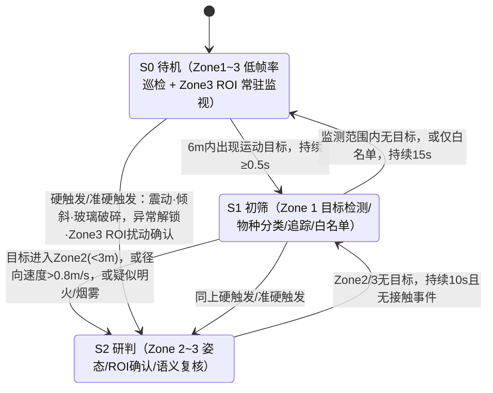

# 智能汽车露营守卫算法流程（模块化解耦版）

---

## 一、系统激活与结束条件

### 1. 激活条件（以下 3 项同时满足才开启）
1. 车辆处于驻车档（P 档）且电子手刹（EPB）已拉起；
2. 中控屏或手机 App 上的"露营守卫"开关置为开启；
3. 所有车门、后备箱已关闭并上锁（未关闭时提示车主，不静默启动）。

**工作模式判定**（决定响应矩阵，见第六章）：
- **车内模式**：车主在车内。优先自动判定（座椅占位/车内传感器 + UWB 钥匙在车内），无相应硬件时由车主手动选择。
- **车外模式**：车内无人。判定方式同上，车主可手动覆盖。
- **野外模式**：车主勾选"野外露营/野生动物区域"，或由定位判定为野外时开启，影响野生动物检测策略（见步骤 1.5）。

### 2. 结束机制

**正常退出（需验证后才终止）**
- 踩下刹车踏板并切出 P 档：直接退出（车内有人操作）；
- 车门解锁（物理钥匙、App、蓝牙钥匙）：进入"**车主验证**"，而不是直接终止：
  - UWB 钥匙在车旁 1.5 米内且鉴权有效 → 正常退出，事件日志保留；
  - 解锁来源无法与 UWB 位置匹配（钥匙不在场或位置异常）→ 判定为**疑似中继攻击/越权解锁**，守卫**不退出**，触发 L3 告警并持续录像。

**故障与降级（不静默退出，均需告警）**

| 故障情形 | 处理方式 |
| :--- | :--- |
| 单路相机被遮挡/失效，持续超过 5 秒 | **L2 告警**（遮挡可能是作案手段），其余相机 + 震动/门状态继续守卫，视野盲区在 App 中提示 |
| 两路及以上相机被遮挡，或遮挡同时出现震动/接触信号 | **L3 告警**，全力保留剩余传感器数据，持续到车主确认 |
| 多路相机 ROI 同时大面积扰动（镜头起雾/剧烈震动/暴雨等环境或设备异常） | 判定为环境/设备异常，不按接触事件处理，转入本表故障流程并告警 |
| 存储空间不足 | 通知车主；L2/L3 事件录像已锁定不覆盖，普通缓存循环覆盖 |
| 边缘计算单元/算法异常 | 降级到"S0 + 震动/门状态"的最小守卫，并上报异常 |

---

## 二、警戒区空间划分

以车辆外轮廓为基准，向外划分四级同心防区。Zone 0~2 的距离为**地面接地点到车身外轮廓**的水平距离；Zone 3 不依赖测距，改用**固定 ROI（感兴趣区域）**判定。

```
   [ Zone 0 远场: 距车身 6.0 m 以外 ]                      ── 不处理（忽略）
  ────────────────────────────────────────────────────────────────────
   [ Zone 1 一级警戒区: 3.0 ~ 6.0 m ]                      ── 外围初筛
  ────────────────────────────────────────────────────────────────────
   [ Zone 2 二级警戒区: 0.5 ~ 3.0 m ]                      ── 核心研判
  ────────────────────────────────────────────────────────────────────
   [ Zone 3 接触区: 0 ~ 0.5 m，基于固定 ROI ]               ── 接触/破坏确认
                     ┌───────────┐
                     │   车 体   │
                     └───────────┘
```

**工程约束**
- 单目测距在远端误差较大：Zone 1/2 的距离按**接地点 + 标定后的相机几何逆投影/畸变校正**估计，判定使用**距离分档**，边界加**迟滞（±0.3 m）**，避免目标在边界抖动造成状态反复切换。
- 6 米外的目标检测与测距不稳定，Zone 0 内的目标不参与任何等级判定。
- **Zone 3 不用距离分档，而用固定 ROI**：相机与车身结构相对固定，门把手、后备箱锁、油箱盖/充电口、自行车架等敏感部件在各路相机画面中的像素坐标可预先标定，定义为固定 ROI，作为低功耗常驻监视和接触判定的基础（详见阶段 0.5）。
- 车主 UWB 钥匙在车周时，S0 不静默：仍由 S1 快速完成白名单过滤（S1 开销小于漏检的代价）。
- **所有"持续 N 秒/N 帧"的判定一律以采集时间戳（毫秒）计算**，不以处理帧数计算，避免处理帧率波动改变规则含义。

| 防区 | 距离/定义 | 主要算法/功能模块 | 核心功能 |
| :--- | :--- | :--- | :--- |
| **Zone 0 远场** | > 6.0 m | 无 | 忽略 |
| **Zone 1 一级警戒区** | 3.0 ~ 6.0 m | **轻量通用目标检测模块**（人/车/通用物体）与**专用火灾烟雾检测模块**双流并行运行 + **野生动物检测模块**（按策略）+ **多目标追踪器**；动物目标送**细粒度物种分类模块** | 目标框、类别、物种、接地测距、径向速度、白名单初筛、记录轨迹 |
| **Zone 2 二级警戒区** | 0.5 ~ 3.0 m | **人体姿态估计模块** + 关键点规则 + **端侧多模态语义复核模块 (VLM)** | 姿态/意图识别（窥探、逼近、冲刺）、滞留判定 |
| **Zone 3 接触区** | 0 ~ 0.5 m，固定 ROI（门把手/后备箱/油箱盖/充电口/行李架等） | 背景建模/光流的 ROI 扰动检测（常驻低功耗）+ 触发后**人体姿态估计模块**确认 | 触车、撬锁、踢踹、装备盗窃等接触类动作的低功耗常驻监视与触发，联动录像与语义复核 |

---

## 三、多源触发与判定原则

**触发源**

| 类别 | 信号 | 作用 |
| :--- | :--- | :--- |
| 视觉 | 环视相机（运动检测、通用检测、物种分类、姿态估计、多模态语义复核） | 发现、分类、行为识别；**可独立判定至 L3** |
| 接触 | IMU/车身震动、倾斜、玻璃破碎特征 | **硬触发**：可直接跳级唤醒到 S2；与视觉证据联合时加速升级并锁定等级 |
| 车身状态 | 车门/后备箱/引擎盖状态、门把手触摸/拉动感应、异常解锁请求、充电口状态 | 接触确认 |
| ROI 扰动 | Zone 3 固定敏感区域（门把手/后备箱/充电口等）的背景建模或光流扰动 | **准硬触发**：多帧确认后直接唤醒至 S2，启动录像与语义复核 |
| 身份 | UWB 钥匙、人脸（**轻量人脸检测与特征提取模块**） | 白名单免打扰 |

**判定原则**
1. **视觉可独立判定至 L3**：视觉证据达到"高置信"门限（见步骤 2.1）时，无需接触信号即可判 L3 并立即响应。
2. **接触信号是加速器与锁定器，而不是前置条件**：视觉达到"中置信"时，与接触信号在 ±2 秒内同时出现，即可升 L3；有接触信号支撑的事件不得被语义复核降级。
3. **误报控制依靠证据质量，不依靠等级封顶**：包括目标未命中白名单、关键点质量与有效帧占比、持续时间与动作特征、ROI 命中，以及端侧大模型异步语义复核（可对纯视觉判定的事件降级，见步骤 2.2）。
4. **野生动物与火情不依赖接触信号**，由物种判定/火势变化与多帧确认直接定级。
5. **ROI 扰动是"区域有变化"的触发与取证信号，本身不是行为证据**：确认后拉起 S2、录像并触发复核，等级由步骤 2.1 的视觉证据分级与步骤 2.2 的语义复核给出。
6. 任何升级都需连续多帧确认（按时间戳计），避免单帧误检。

---

## 四、四级威胁分级体系

根据**"目标类别/物种 + 所处防区 + 行为/滞留特征 + 接触信号"**综合判定，命中任一即触发，取最高等级。

| 等级 | 定义 | 触发条件 | 系统动作 |
| :--- | :--- | :--- | :--- |
| **L0 安全** | 无威胁 / 已知免扰 | 1. 防区内无移动实体；<br>2. 目标命中白名单（UWB 或人脸）；<br>3. 判定为飞虫、草木风噪、雨雪、已建模的营地物品（帐篷/天幕/椅子摆动）；<br>4. "篝火/炉具"火源稳定有人看管 | 静默日志 |
| **L1 提示** | 陌生实体常规经过 | 1. 陌生人员在 Zone 1 且累计滞留 ≤ 30 秒；<br>2. 陌生人员进入 Zone 2 且累计滞留 ≤ 10 秒；<br>3. 物种分类为**无害小型动物**（鸟类/松鼠等）活动，或**需关注类**动物出现在 Zone 1；<br>4. 陌生车辆在 Zone 1 通过 | 启动检测与追踪，记录轨迹与日志；不打扰车主 |
| **L2 预警** | 可疑徘徊、窥探、疑似接触、环境风险 | 1. 陌生人员在 Zone 1 累计滞留 > 30 秒，或在 Zone 2 累计滞留 > 10 秒；<br>2. **贴窗窥探**：头部位于车窗区域 0.5 m 内且朝向车窗，持续 ≥ 3 秒；<br>3. 视觉**中置信**的疑似拉门撬锁/蓄意踢踹/装备盗窃（见步骤 2.1）；<br>4. **大型猛兽**在 Zone 1/2 徘徊（物种分类为大型猛兽，或"未定性大型动物"经体型兜底判定，见步骤 1.5）；<br>5. 快速径向逼近（人：> 1.5 m/s 且指向车身进入 Zone 2）；<br>6. 无人看管的火源（Zone 1/2 稳定火焰，无人在场 > 5 分钟）；<br>7. 单路相机被遮挡 > 5 秒；<br>8. Zone 3 内 ROI 扰动多帧确认，姿态判定或语义复核尚未完成或未达中置信（见阶段 0.5） | 事件录像加密锁定（事前 10 秒至事后 20 秒）；按模式响应（见阶段 3） |
| **L3 紧急** | 侵入破坏、触车行窃、猛兽冲刺、火灾、防篡改 | 1. **拉门撬锁**：视觉高置信；或视觉中置信 + 接触信号（把手/锁被拉动、异常解锁请求、震动，±2 秒）；<br>2. **踢踹/撞击**：视觉高置信；或视觉中置信 + 车身震动峰值；<br>3. **装备盗窃**：视觉高置信；或视觉中置信 + 车身状态变化；<br>4. **猛兽冲刺**：大型猛兽（含体型兜底判定的潜在猛兽）朝车辆径向逼近速度 > 1.2 m/s，持续 ≥ 0.5 秒且不少于 3 个有效检测帧，进入 Zone 2；<br>5. **火情蔓延**：火焰面积持续增大且距车 < 3 m，或浓烟逼近车体；<br>6. 玻璃破碎特征、车辆倾斜/被抬升；<br>7. 两路及以上相机被遮挡；疑似中继攻击/越权解锁；<br>8. 语义复核对中置信事件高置信确认为人为破坏行为 | 事件录像加盖防篡改时间戳落盘；手机强提醒；按模式响应（见阶段 3） |

**累计滞留规则**：同一目标（trace ID）短暂离开防区后 10 秒内重新进入，滞留计时**累计**而不是清零，防止"来回试探"绕过阈值。跨相机/长时关联导致的身份不确定性，按步骤 1.6 的"下界/上界"规则处理。

**速度规则**：所有速度判定使用**径向分量**（朝车身方向），切向经过（如路过慢跑者）不计入；速度超阈值仅用于**唤醒 S2 和加权研判**，不单独升到 L3（猛兽冲刺除外，需类别 + 持续确认）。

---

## 五、运行状态与流转

### 1. 状态定义

| 状态 | 关联防区 | 计算资源 | 运行算法/功能模块 |
| :--- | :--- | :--- | :--- |
| **S0 待机** | 车周监测范围（Zone 1~3，Zone 0 忽略） | 低功耗相机流（低帧率/低分辨率）+ IMU + 车身状态信号；不运行深度神经网络推理 | 背景建模运动检测（含风噪/营地物品建模）；Zone 3 固定 ROI 扰动检测（常驻，见阶段 0.5）；环形缓冲低码率录像 |
| **S1 初筛** | Zone 1 | 四路相机（正常帧率）；常驻小模型流水线（低占空比轮询） | **轻量通用目标检测模块**与**专用火灾烟雾检测模块**双流并发运行（Parallel Ensemble，主流检人/车/动物，副流检火/烟）、多目标追踪器、单目测距、径向速度、**细粒度物种分类模块**、UWB/人脸白名单（**轻量人脸检测与特征提取模块**）；Zone 3 ROI 扰动检测（常驻）；环形缓冲录像 |
| **S2 研判** | Zone 2 / Zone 3 | 四路相机；按需唤醒模型流水线 | 通用检测与火灾检测双流并发维持运行 + **人体姿态估计模块** + 关键点规则判定、接触信号融合、**行人重识别 (ReID) 特征提取模块**（事件触发）、**端侧多模态大模型 (VLM) 语义复核模块**（异步）；Zone 3 ROI 扰动检测（常驻）；环形缓冲录像 |

> **说明 1**：Zone 3 的 ROI 扰动检测计算量极小，作为**独立于主状态机的常驻通路**，在 S0/S1/S2 任一阶段都持续运行，不随主状态回落而关闭。一旦确认扰动，直接把主状态机拉到 S2。
> **说明 2**：系统采用"常驻轻量模型 / 按需唤醒模型"的分层调度机制。所有模型常驻显存，S0 仅停止推理调度而不卸载权重，彻底消除运行时的模型加载延迟。

### 2. 状态流转



| 流转 | 条件 | 说明 |
| :--- | :--- | :--- |
| S0 → S1 | 运动检测在 Zone 1~3 内持续 ≥ 0.5 秒确认 | 防单帧噪声 |
| S0/S1 → S2（硬触发/准硬触发） | 任一硬触发（震动/倾斜/玻璃破碎/异常解锁/门把手异常）或 **Zone 3 ROI 扰动多帧确认** | 跳级唤醒，同时启动事件录像与语义复核，不等待常规防区分流 |
| S1 → S2（常规升级） | 目标进入 Zone 2（<3 m，含迟滞）；或径向逼近速度 > 0.8 m/s；或疑似明火/烟雾 | |
| S2 → S1 | Zone 2/3 无目标持续 10 秒，且无接触事件 | 关闭姿态估计与重识别调度；Zone 3 ROI 常驻监视不受影响，继续运行 |
| S1 → S0 | 监测范围内无目标或仅白名单目标，持续 15 秒 | 停止视觉模型推理调度与高帧率流；Zone 3 ROI 常驻监视不受影响，继续运行 |
| 事件冷却 | 发生 L2/L3 事件后，至少保持 S1 60 秒再回落 | 防频繁抖动 |

---

## 六、算法端到端执行流程

### 阶段 0：S0 待机巡检
- **输入**：低功耗相机流、IMU、车身状态信号。
- **执行**：
  1. 在 Zone 1~3 的地面投影范围内做背景建模运动检测（Zone 0 屏蔽）；Zone 3 另有独立的固定 ROI 扰动监视，常驻运行，见阶段 0.5；
  2. 运动面积、持续时间、轨迹过滤：滤除飞虫、雨雪、树枝摆动、帐篷/天幕抖动；
  3. 持续将低码率画面写入环形缓冲，用于事件"事前 10 秒"预录；
  4. 满足流转条件时进入 S1；硬触发/准硬触发（含 Zone 3 ROI 扰动确认）时直接进入 S2。

### 阶段 0.5：Zone 3 常驻 ROI 监视（跨状态并行运行）

- **定位**：与 S0/S1/S2 主状态机并行的独立低功耗通路，不随主状态回落而关闭，专门监视车身敏感部件的极近距离接触。目标检测和姿态估计在贴近车身、遮挡严重时不稳定，这条通路作为兜底。
- **前提**：相机与车身结构相对固定，门把手、后备箱锁、油箱盖/充电口、自行车架等部位在各路相机画面中的像素位置可预先标定，定义为固定 ROI（通常由能看到把手的左右两路相机，以及覆盖后备箱/充电口的相机负责）。
- **执行**：
  1. 对每个 ROI 用轻量背景建模或光流强度做低帧率（1~2 fps）常驻扰动检测，不依赖深度神经网络，计算开销极低；
  2. 扰动幅度超过阈值且**连续多帧确认**（过滤单帧噪声）时，判定为"ROI 扰动事件"；
  3. **全局异常判断**：若同一时刻多路相机的 ROI 同时大面积扰动（如镜头起雾、剧烈震动、暴雨），判定为环境/设备异常，转入第一章故障处理流程，不按接触事件处理；
  4. ROI 扰动事件确认后：
     - 若主状态机处于 S0/S1，**直接跳转至 S2**（无论此前是否已有目标被追踪到），并按统一规则截取事件前 10 秒至事后 20 秒视频；
     - 对 ROI 周围裁剪区域调用**轻量通用目标检测模块**检测人体，再送入**人体姿态估计模块**，并尝试与既有轨迹关联，执行步骤 2.1 的判定；
     - 触发**端侧多模态语义复核模块**（步骤 2.2）；
  5. **等级判定**：ROI 扰动本身不定级，等级由步骤 2.1 的视觉证据分级与步骤 2.2 的语义复核给出。姿态估计因遮挡失败、又缺少接触信号时，以**语义复核结果**为准：高置信确认为人为接触/破坏 → 可直接 L3；未确认前先按 L2 响应。
- **误报抑制**：
  - 光照变化（云影、车灯扫过、自动曝光跳变）优先用背景自适应算法抑制；
  - 环境物体（树枝、雨雪、昆虫、悬挂物）通过 ROI 范围收窄（贴近实际部件轮廓）和多帧确认降低；
  - 各 ROI 的阈值需按车型、相机安装角度、部件材质反光情况分别标定。

### 阶段 1：S1 初筛、白名单与防区分流

#### 步骤 1.1：检测、追踪与测距（双流并发检测架构）
1. **双流并发检测 (Parallel Ensemble Detection)**：
   - 在 S1 初筛阶段，每路相机画面同时送入**轻量通用目标检测模块**与**专用火灾烟雾检测模块**，采用**双流并发（多线程 / 异步 CUDA 流）同时执行推理**；
   - **主流（通用目标检测）**：检测人员（`person`）、车辆（`car`）及通用动物（`animal`）；
   - **副流（火灾烟雾检测）**：检测火焰（`fire`）与烟雾羽流（`smoke`）；
   - **结果合并**：两路检测输出的目标类别完全解耦互斥，底层完成非重叠类别候选框的直接合并，统一送入下游追踪与逻辑处理，确保对人车威胁与火情隐患同时具备全天候感知能力。
2. **野生动物检测模块（按策略协同）**：
   - 作为第三路专用动物检测器，按步骤 1.5 的策略运行（野外模式同频并行，常规模式触发式运行）；
   - 输出与通用检测模块按类别优先级合并：人/车以通用检测为准，动物以野生动物检测为准，IoU > 0.5 的重复框自动去重融合。
3. **多目标追踪与物理测距**：
   - 经合并后的全量目标送入多目标追踪器（ByteTrack）统一分配轨迹 ID (track ID)；
   - 结合标定几何逆投影（IPM）计算目标接地点到车身的物理距离（应用 ±0.3m 迟滞滤波）与径向逼近速度；
4. **类别分流处理**：
   - **人**：立即进入白名单判定（步骤 1.2）；
   - **车辆**：Zone 1 内记录 L1；
   - **动物**：进入细粒度物种分类与危险等级映射（步骤 1.5）；
   - **火焰/烟雾**：直接送入火情时序研判引擎（步骤 1.4）。

#### 步骤 1.2：白名单双通道判定（命中后该目标为 L0）
- **通道 A（UWB 空间对齐）**：UWB 测得的钥匙坐标与视觉人体接地坐标水平距离 ≤ 1.2 米，且钥匙鉴权有效 → 车主。
  - **多人同处**：1.2 米内有多个候选人时，不做 UWB 单独判定，需结合通道 B；
- **通道 B（人脸，需硬件支持）**：人体距车身 ≤ 2 米且面部朝向车身。对人体框上半部分裁剪后送入**轻量人脸检测模块**定位人脸，再调用**人脸特征提取模块**输出特征向量，与本地底库做余弦相似度比对。
  - 相似度阈值须在自有数据（含夜间/红外）上标定；
  - 活体检测需近红外相机与专用活体模块支持；无活体能力时，通道 B 仅作辅助证据，不作为唯一放行依据（须与通道 A 联合，或经车主确认）。
- **白名单绑定与失效**：白名单身份与轨迹 ID (track ID) 绑定，避免重复识别；但当 **track 丢失/遮挡超过 3 秒、发生 ID 切换或多人 track 合并**时，身份失效，需重新验证（防止陌生人"借用"车主身份）。
- 白名单目标豁免所有告警，但**事件日志仍全程记录**。
- 均未命中 → 标记为陌生目标，进入防区判定。

#### 步骤 1.3：防区分流与等级判定
- Zone 0：忽略；
- 陌生人员：Zone 1 累计滞留 ≤ 30 秒为 L1，> 30 秒为 L2；进入 Zone 2 后按第四章规则判定；
- 速度：径向逼近速度 > 0.8 m/s 唤醒 S2（不直接升 L3）；
- 状态流转按第五章执行。

#### 步骤 1.4：火情判定（基于双流并发火灾检测流）
- **实时同步感知**：火情检测由步骤 1.1 中**与通用检测双流并发同时运行的专用火灾检测流实时提供**，无需外部低频轮询，每帧均具备毫秒级明火与烟雾捕获能力；
- **稳定火源监控**：常见的篝火、炉具、烧烤等面积位置不发生剧烈突变，CampfireMonitor 模块持续监控并静默记录：
  - 火源位于 Zone 2 之外，记录并推送通知，持续更新火源面积与烟雾扩散方向；
  - 稳定火源 + 白名单人员在场 → 判定为正常生活营火（L0）；
  - 稳定火源无人看管超过 5 分钟 → 提醒车主回看火源（L2）；
- **失控火源紧急告警**：
  - **火焰面积持续增大且进入 Zone 2（< 3m），或浓烟扑向车体 → 标记为失控火情，直接升 L3**；
- 火情响应以**通知车主、唤醒、持续告警**为主，不使用车外灯光/警报等“驱逐”动作。

#### 步骤 1.5：野生动物检测与物种分类

- **目的**：露营场景需要区分"无害小动物"与"大型猛兽"。通用检测器的动物类别有限，缺少狼、野猪、鹿、狐等常见野生物种，单靠通用检测器无法满足，因此采用**"动物检测 → 物种分类 → 危险等级映射"三级策略**。
- **三级流程**：
  1. **检测**：**野生动物专用检测器**输出通用动物边界框（animal），不依赖物种名称；
  2. **分类**：对动物框外扩约 10~20% 后裁剪归一化，送入**细粒度物种分类模块**，输出物种名称与置信度；
  3. **映射**：物种 → 危险类别 → 第四章威胁规则。
- **野生动物检测器运行策略**（控制并行检测器的叠加计算开销）：
  - **野外模式**：与通用检测器同频并行（约 5 FPS/路）；
  - **常规模式**：触发式运行（约 1 FPS/路，持续至目标定性完毕），满足任一即启动：(a) S0 运动门控触发，但通用检测器未检出人/车；(b) 通用检测器输出动物类或低置信未知目标；(c) 夜间/红外下通用检测器整体置信度偏低。
- **轨迹级聚合**：对同一 track 保留若干张高质量裁剪（框面积大、置信度高、未截断、未遮挡），逐张分类后做投票/平均。初始规则：累计 ≥ 3 张一致，且平均 top-1 概率 ≥ 0.7 时"定性"；目标逼近或持续滞留时周期性复核。
- **危险类别映射**（名单与等级由地区配置，下表为标准映射范式）：

| 类别 | 示例物种 | 等级规则 |
| :--- | :--- | :--- |
| **大型猛兽** | 熊科、狼、野猪、大型猫科（狮/虎/豹/美洲狮等） | Zone 1/2 徘徊 → L2；径向逼近速度 > 1.2 m/s 进入 Zone 2 → L3 |
| **需关注** | 野犬/流浪狗、狐狸、大型有蹄类（鹿/羚羊/马等） | Zone 1 出现 → L1；持续逼近或翻动营地物品 → L2 |
| **无害小型** | 鸟类、松鼠、兔类、刺猬、小型啮齿类 | L1，仅记录 |
| **未定性** | 分类低置信，或不在物种库内 | **体型兜底**：按框尺寸结合接地测距估算体型，大体型按大型猛兽处理（L2），小体型按 L1；同时触发语义复核描述 |

- **与人的互校验**：野生动物检测器判为 animal 的框，若与通用检测器的人体框 IoU > 0.5，以人体为准，避免蹲伏或弯腰的人被误判为动物。

#### 步骤 1.6：跨相机/长时关联与外观特征

- **全局轨迹**：各路相机的局部轨迹，经标定投影到以车体为中心的统一地面坐标系，由全局轨迹管理器按"位置 + 时间窗"关联，滞留时间、绕车角度等挂在全局身份上。
- **行人重识别 (ReID) 特征仅在以下时刻提取**，不逐帧运行：(a) 目标首次稳定追踪，建立外观锚点；(b) 相机交接或交叉遮挡出现歧义；(c) 丢轨后目标重现；(d) 白名单身份重新确认。
- **融合打分**：位置、时间、外观三项加权，任一单项都不单独决定合并；**证据不足时不合并**，保留候选并延迟决策，宁可拆开，不强行并入。
- **滞留时间用区间表示**：
  - **下界**：只累计已确认属于同一人的部分；
  - **上界**：假设所有存疑交接均为同一人时的累计；
  - 下界达到阈值 → 正常触发；仅上界达到 → 提升关注与取证质量，不直接升级告警。
- **夜间红外下颜色信息缺失**，外观特征权重应降低，更多依赖时空连续性约束。

### 阶段 2：S2 研判

#### 步骤 2.1：姿态与动作判定
- **触发来源**：目标追踪进入 Zone 2/3 后的持续姿态判定；或阶段 0.5 的 Zone 3 ROI 扰动事件触发。
- **输入**：环视相机帧 + 震动/车身状态信号 + Zone 3 ROI 扰动信号。
- **执行**：通用检测器人体框 → 裁剪输入至**人体姿态估计模块**输出骨骼关键点 → 关键点规则与时序特征（位移、速度、往复次数、停留时间）→ 视觉证据分级。

**视觉证据分级**

| 行为 | 防区 | 中置信（→ L2） | 高置信（视觉单独 → L3） | 接触信号加成（中置信 + 接触 → L3） |
| :--- | :--- | :--- | :--- | :--- |
| **近车徘徊** | Zone 2 | 陌生人员无明确破坏动作，累计滞留 > 10 秒 | — | — |
| **贴窗窥探** | Zone 2/3 | 头部位于车窗区域 0.5 m 内，朝向车窗，持续 ≥ 3 秒 | — | — |
| **拉门撬锁** | Zone 3 | 手腕在门把手 ROI（把手周围约 25 cm）内持续 ≥ 0.8 秒 | ROI 内持续 ≥ 1.5 秒，且出现 ≥ 2 次往复拉动特征（腕部位移振荡） | + 把手/锁被拉动、异常解锁请求或震动（±2 秒） |
| **蓄意踢踹** | Zone 3 | 足部关键点朝向车身的快速摆动特征 1 次（速度明显高于步行摆腿） | 5 秒内 ≥ 2 次踢击特征，且足部位于 Zone 3 | + 车身震动峰值（±2 秒） |
| **装备盗窃** | Zone 3 | 手部在车顶行李箱/自行车架/充电口 ROI 内持续 ≥ 1.0 秒 | 持续 ≥ 2.0 秒，且手腕有取/拆位移特征 | + 车身状态变化 |
| **猛兽冲刺** | Zone 2 | — | 见第四章 L3 第 4 项 | — |

> 徘徊、窥探类行为本身的威胁等级定义为 L2；若同一目标叠加了高危行为，则按高危行为定级。

**通用证据质量要求**（适用于所有行为）：
- 目标未命中白名单；
- 判定所依赖的关键点（腕/踝/头）平均置信度 ≥ 0.5，且有效帧占比 ≥ 70%；
- 持续时间以时间戳计；
- 关键点因遮挡缺失时，只能累计到"中置信"，须由语义复核或接触信号补强后才可升 L3。

#### 步骤 2.2：端侧多模态语义复核（VLM 异步慢通路）
- **定位**：端侧视觉语言大模型 (VLM) 异步研判通路。
- **输入**：事件发生期间的关键帧（建议 1~3 张高清晰度切片）及上下文提示词。
- **唤醒门控**：
  1. 目标检测识别为未知障碍物、检测置信度低于门限，或动物"未定性"；
  2. 快通路已触发 L2/L3，需要为车主生成自然语言可读的情况总结；
  3. 视觉中置信、尚无接触信号支撑的事件（如装备盗窃）需要深度复核；
  4. 阶段 0.5 触发的 Zone 3 ROI 扰动事件，需要判断扰动是否为人为接触及具体行为类型。
- **输出**：结构化结果（行为类别、置信度）+ 不超过 50 字的自然语言说明（例如："发现一名穿深色卫衣的人员正尝试撬动左前门把手"）。
- **权限约束**：
  - **可升级**：对中置信事件，语义复核高置信确认为恶意破坏行为 → 升 L3；
  - **可降级纯视觉事件**：对无接触信号支撑的 L2/L3，语义复核高置信否定 → 降一级，录像保留，并追加"已复核降级"通知；
  - **不得降级有接触信号支撑的事件**；
  - 异步复核的耗时**不阻塞**快通路响应与存证；
  - 异步大模型与实时视觉小模型共享计算硬件，同一时刻限 1 个复核任务，多次请求排队合并。

### 阶段 3：响应动作矩阵

| 等级 | 车内模式（车主在车内） | 车外模式（车内无人） |
| :--- | :--- | :--- |
| **L1** | 仅日志记录 | 仅日志记录 |
| **L2** | 1. 事件录像加密锁定；<br>2. App 静默通知；<br>3. 座舱屏幕最低亮度显示外景（可选，默认关闭） | 1. 事件录像加密锁定；<br>2. App 常规图文通知；<br>3. 车底照地灯低照度补光 |
| **L3** | 1. App 最高优先级强提醒；<br>2. 主驾座椅脉冲震动唤醒车主；<br>3. 完整事件视频加盖防篡改时间戳落盘；<br>4. **升级驱逐**（可选，默认开启）：车主 30 秒内未响应，或接触事件持续，自动启动车外灯光/声音驱逐 | 1. 大灯/日间行车灯高频爆闪 3 次；<br>2. 车外扬声器播放警示音；<br>3. App 立即弹出紧急推送；<br>4. 完整事件视频加盖防篡改时间戳落盘 |
| **火情 L3** | 座椅震动 + App 强提醒 + 车内提示音，提示车主撤离 | App 强提醒 + 车外持续声光提示；不使用"驱逐"动作 |

**响应规则**
- **视觉单独判定的 L3 与有接触信号支撑的 L3 响应一致，立即执行全套动作**（先响应、后纠偏）；若语义复核随后高置信否定，则终止持续性声光动作，并追加降级通知。
- **野生动物场景**：车外声光驱逐是否启用、强度如何，按物种类别与地区建议配置；车内模式下默认只做 App 与座椅提醒，由车主决定是否启用车外驱逐。

### 阶段 4：事件管理与安全存证

事件管理模块负责威胁事件的全生命周期管控，涵盖**事件智能判定触发、高可靠防抖去重、事前事后视频安全锁存、基于 SHA-256 的哈希链防篡改存证**以及**多通道分级推送报文生成**。

```
                       【阶段 4: 事件管理与存证全流程】
 ┌────────────────┐     ┌────────────────┐     ┌────────────────┐
 │ 多源判定触发   │ ──▶ │ 60s防抖去重    │ ──▶ │ 30s录像安全锁存 │
 │ (视觉/接触/ROI)│     │ 与等级跃迁控制 │     │ (前10s + 后20s)│
 └────────────────┘     └────────────────┘     └────────────────┘
                                                        │
          ┌─────────────────────────────────────────────┴────────────┐
          ▼                                                          ▼
 ┌────────────────────────┐                                ┌────────────────────────┐
 │ 哈希链防篡改存证       │                                │ 多通道结构化消息分发   │
 │ (SHA-256 顺序哈希链)   │                                │ (App强推/JSON报文/卡片)│
 └────────────────────────┘                                └────────────────────────┘
```

#### 4.1 事件生成与生命周期触发逻辑

1. **触发源与前置判定准则**：
   - **视觉高置信触发**：在 S1/S2 状态下，任意陌生实体满足第四章 L2 或 L3 视觉规则（如 Zone 2 持续滞留超时、贴窗窥探 ≥ 3s、手腕在把手 ROI 内往复振荡、猛兽径向逼近 > 1.2 m/s 等）；
   - **物理接触硬触发**：车辆 IMU 产生剧烈震动峰值、倾斜角度突变、玻璃破碎特征波形、车门/后备箱强行拉动或异常越权解锁信号（直接跳级激活并锁定）；
   - **敏感部位 ROI 准硬触发**：Zone 3 门把手、充电口、车锁等固定 ROI 背景扰动经连续多帧确认；
   - **火情失控触发**：明火持续扩大进入 Zone 2（< 3m）或浓烟扑向车身。
2. **事件生命周期状态机 (Event Lifecycle State)**：
   - `INIT (创建)`：系统捕获异常瞬间分配全局唯一事件标识符 `event_id`（格式：`EVT_YYYYMMDD_HHMMSS_UUID8`），固化初始触发时间戳与授时源；
   - `ACTIVE (研判)`：多帧聚合追踪，持续计算目标物理测距、径向速度与在防区内的累积滞留时长；
   - `LATCHED (锁定)`：事件等级达到 L2/L3 阈值瞬间锁定，立即触发即时报警推送，并驱动视频录制引擎截取事前事后画面；
   - `COOLING (冷却)`：进入 60 秒防刷屏冷却窗口，同主体事件静默更新时间线；
   - `FINALIZED (闭环归档)`：目标离开防区持续 ≥ 30 秒或车主确认解除，事后视频切片封口，加盖哈希链防篡改时间戳落盘归档。
3. **时序防抖、去重与等级跃迁机制**：
   - **防误报时序滤波**：所有行为判定一律基于连续物理采集时间戳判定（如徘徊持续满 10s/30s，撬锁往复振荡满 1.5s），杜绝单帧算法毛刺与瞬时扰动误报；
   - **短时离开累计不清零**：同一目标实体（Trace ID 或 ReID 绑定的全局人员会话）短暂离开防区后 **10 秒内重新进入，滞留计时持续累加而非清零**，彻底防止“频繁进出边缘”规避警报；
   - **60 秒同级防刷屏冷却**：同一追踪目标、同一敏感 ROI 部位、同一威胁等级的事件，在 **60 秒冷却期内禁止重复弹窗推送**，多帧信息自动聚合成单条时间线；
   - **高危等级跃迁突破 (Upgrade Bypass)**：若在 60 秒冷却期内事件发生恶化（例如：由 L2 徘徊升级为 L3 拉门撬锁，或视觉中置信突然收到车身 IMU 震动加成），**系统立即强行突破冷却限制，瞬间中断静默，触发 L3 最高优先级即时推送与整车警示驱逐**！

---

#### 4.2 视频录制、加密存储与防篡改存证机制

1. **双轨滚动环形缓冲机制 (Dual-Ring Buffer)**：
   - 视频流接入后持续写入内存滚动环形队列，默认保留 **15 秒** 历史画面；
   - **内存轻量压缩**：内存帧以高压缩比 JPEG 字节流缓存，较原始未压缩图像节省 **95% 以上物理内存**，彻底杜绝长时间待机下的内存泄漏与 OOM 隐患。
2. **30 秒标准事件录像切片规范 (Pre-10s + Post-20s = 30s)**：
   - **事前 10 秒回溯 (Pre-Trigger 10s)**：事件锁定的瞬间，录像引擎立即从环形队列中回溯抽取触发前 10 秒历史帧，精准还原作案动机与逼近轨迹；
   - **事后 20 秒持续追踪 (Post-Trigger 20s)**：在后台注册持续 20 秒的异步录像任务，完整收录接触破坏动作与逃窜路线；
   - **恒定 30.0 FPS 时间戳重采样对齐**：根据每帧采集时间戳严格执行等间距线性插值重采样，**彻底消除系统抽帧、变帧率或推理抖动导致的视频快放/慢放失真**，确保录像严格以 1.0x 真实流速播放。
3. **安全存储分区与加密落盘 (Secure Storage Partition)**：
   - 视频文件统一写入车载安全存储分区（`/secure_storage/events/`），采用 H.264/MP4 标准硬件编码封装；
   - 视频文件命名严格规范为：`{event_id}_{trigger_timestamp}.mp4`；
   - 视频落盘完成后，系统底层立即读取文件二进制流并计算整份文件的 **SHA-256 完整性校验和**。
4. **基于 SHA-256 的单向哈希链存证机制**：
   - 采用创世区块 (`GENESIS_HASH`) 起始的单向密码学哈希链，按事件发生顺序依序串联；
   - 每个锁存事件记录为一个防篡改区块，有效载荷包含：
     * 区块索引号 (`block_index`) 与事件编号 (`event_id`)；
     * 触发时间戳与 ISO-8601 标准时间字符串；
     * 硬件时钟信任源（`GNSS_PPS_SYNC` 卫星原子授时、`CELLULAR_NTP` 基站授时、`LOCAL_RTC` 本地硬件时钟）；
     * 录像文件名称与视频二进制流 SHA-256 校验和 (`video_file_sha256`)；
     * 目标感知画像（类别、物种、测距、防区累积滞留时长、径向逼近速度）；
     * 行为判定与上下文（动作类别、受扰车身 ROI、是否物理接触联合确认、整车联动动作、大模型研判摘要）；
     * 前序区块哈希值 (`prev_hash`)。
   - 对区块有效载荷执行字典序排序序列化后，计算 SHA-256 获得当前区块哈希 (`block_hash`)，并追加写入存证清单 `evidence_manifest.jsonl`；
   - **完整性校验**：通过前后区块哈希的严格链接校验，任何对历史录像文件、时间戳或事件属性的篡改或删除都会导致整条哈希链校验断裂，以此保证事件存证的客观与真实。
5. **存储配额与智能分级淘汰管理 (Storage Quota & Retention Policy)**：
   - **分区配额**：车载专用存证存储分区默认分配 16 GB ~ 32 GB 独立存储空间；
   - **分级锁存保护**：
     * L0/L1 常规巡检缓存：采用循环覆盖（FIFO）机制，自动保留最近 24~48 小时；
     * L2/L3 事件录像与元数据卡片：**加盖只读物理保护锁（LOCKED Flag）**，禁止普通巡检流覆盖；
   - **高水位预警与智能淘汰机制**：
     * **占用达 80%（黄色预警）**：手机 App 提示“守卫存储空间即将耗尽，请及时导出历史事件”；
     * **占用达 90%（红色预警）**：启动智能修剪淘汰策略，按照“时间最久远 → 威胁等级较低（优先淘汰 L2 预警录像，保留高危 L3 录像）”的顺序逐步释放，**严禁静默丢弃未备份确认的 L3 紧急事件录像**。

---

#### 4.3 多通道分级推送策略

系统建立端云协同的多通道分级警报分发机制，根据威胁严重程度执行差异化推送：

| 等级 | 推送通道与展现形态 | 交互策略 | 是否静默 |
| :--- | :--- | :--- | :---: |
| **L1 提示** | 仅写入车载本地安全日志与 App 历史时间线 | 无弹窗、无震动、不发推送声音 | 是 |
| **L2 预警** | 手机 App 标准图文推送栏通知；座舱中控屏以最低亮度静默显示车周画面（车内模式） | 包含威胁摘要、目标方位与抓拍略缩图；点击可回放 30s 录像 | 否 |
| **L3 紧急** | **全通道最高优先级强提醒**：<br>1. 手机 App 全屏报警弹窗 + 持续脉冲震动（破防手机系统免打扰模式）；<br>2. 车载主驾座椅脉冲震动唤醒车主；<br>3. 大灯高频爆闪 3 次 + 车外扬声器定向警示音；<br>4. 车联网云端平台 (TSP) 同步归档告警 | 顶级强提醒；App 弹出“一键鸣笛驱逐”、“一键报警”及“查看实时监控”快捷操作卡片 | 否 |

---

#### 4.4 消息推送标准协议与数据格式规范

面向车主手机 App、车机中控屏及车联网云端（TSP）发布标准结构化 JSON 报文，统一协议版本为 `v1.0`：

```json
{
  "version": "1.0",
  "event_id": "EVT_20261012_021530_A8F9B2",
  "timestamp": 1791771330.452,
  "iso_time": "2026-10-12T02:15:30.452Z",
  "threat_level": "L3_CRITICAL",
  "urgency": "EMERGENCY",
  "notification": {
    "title": "🚨【紧急高危】车周检测到异常侵入与拉门接触！",
    "body": "目标: 可疑人员 (ID:12) | 距离: 0.3m (左侧车身Zone3) | 滞留徘徊: 18.5s | 行为: 尝试拉动左前门把手 | 物理接触: 已联合确认",
    "vlm_summary": "监控画面复核：发现一名穿深色连帽卫衣的人员正持续拉动左前门把手，意图侵入车内。"
  },
  "target": {
    "category": "person",
    "species": null,
    "species_cn": null,
    "track_id": 12,
    "session_id": "person_session_003",
    "distance_m": 0.32,
    "dwell_time_sec": 18.5,
    "radial_speed_mps": -0.45,
    "zone": "ZONE_3_CONTACT",
    "is_whitelisted": false
  },
  "context": {
    "operating_mode": "CAMPING_IN_CAR",
    "action_type": "DOOR_HANDLE_PRY",
    "description": "手腕进入左前门把手ROI区域持续1.8秒且位移呈现往复拉动，同时车门拉动感应触发",
    "has_contact_signal": true,
    "disturbed_rois": ["handle_fl"],
    "executed_actions": [
      "APP_EMERGENCY_ALERT",
      "SEAT_VIBRATION_PULSE",
      "AUTO_RECORD_EVIDENCE_30S",
      "HEADLIGHT_STROBE_3X"
    ]
  },
  "evidence": {
    "video_clip_path": "/secure_storage/events/EVT_20261012_021530_A8F9B2_1791771330.mp4",
    "video_duration_sec": 30.0,
    "video_fps": 30.0,
    "video_sha256": "e3b0c44298fc1c149afbf4c8996fb92427ae41e4649b934ca495991b7852b855",
    "snapshot_url": "https://vehicle-iot.brand.com/evidence/snapshot/EVT_20261012_021530_A8F9B2.jpg",
    "hash_signature": "7d5b88523c91a0cf... (防篡改区块SHA-256)",
    "clock_source": "GNSS_PPS_SYNC"
  }
}
```

##### 报文字段详细释义表：

| 顶层节点 | 字段名 | 类型 | 说明与规范要求 |
| :--- | :--- | :---: | :--- |
| **基础属性** | `event_id` | String | 全局唯一事件 ID，格式为 `EVT_年月日_时分秒_随机码` |
| | `timestamp` / `iso_time` | Float / String | 秒级高精度时间戳及 UTC ISO-8601 标准时间 |
| | `threat_level` | String | `L0_SAFE` / `L1_NOTICE` / `L2_WARNING` / `L3_CRITICAL` |
| | `urgency` | String | 推送通道紧急度优先级：`NORMAL` / `INFO` / `WARNING` / `EMERGENCY` |
| **通知正文 (`notification`)** | `title` | String | 面向手机端弹窗的加粗报警标题 |
| | `body` | String | 结构化关键信息字符串（类别+方位+测距+滞留时间+行为摘要） |
| | `vlm_summary` | String | 端侧多模态大模型生成的通俗自然语言复核结论（≤ 50 字） |
| **目标画像 (`target`)** | `category` / `species` | String | 通用目标大类及细粒度物种名称（如 `brown_bear`、`wild_boar`） |
| | `track_id` / `session_id` | Int / String | 单目跟踪局部 Track ID 及全局跨相机人员会话 Session ID |
| | `distance_m` | Float | 单目接地反投影测量的物理水平距离（米） |
| | `dwell_time_sec` | Float | **关键指标**：目标在警戒防区内**持续累积徘徊滞留时间（秒）** |
| | `radial_speed_mps` | Float | 径向逼近速度（m/s，负数表示正向车身快速逼近） |
| | `zone` | String | 所处防区分级（`ZONE_1_OUTER` / `ZONE_2_INNER` / `ZONE_3_CONTACT`） |
| **上下文 (`context`)** | `operating_mode` | String | 当前整车守卫工作模式（车内模式 / 车外模式 / 野外模式） |
| | `action_type` | String | 细粒度行为特征（如 `WINDOW_PEEK`、`DOOR_HANDLE_PRY`、`IMPACT_KICK`） |
| | `has_contact_signal` | Bool | 是否获得车身 IMU 震动或物理接触传感器硬件硬信号支撑 |
| | `disturbed_rois` | Array | 触发扰动的敏感部位 ROI 标识列表（如 `handle_fl`、`roof_rack`） |
| | `executed_actions` | Array | 联动执行的硬件防御动作列表（座椅震动、爆闪、警示音等） |
| **存证审计 (`evidence`)** | `video_clip_path` | String | 30 秒加密视频切片本地绝对路径或安全文件 URI |
| | `video_sha256` | String | 视频文件的二进制完整性 SHA-256 校验和 |
| | `hash_signature` | String | 当前事件在防篡改单向哈希链中的 `block_hash` 签名 |
| | `clock_source` | String | 硬件时钟信任等级（`GNSS_PPS_SYNC` / `CELLULAR_NTP`） |

---

#### 4.5 人类高可读性事件审计卡片规范 (Audit Card Layout)

在座舱中控屏历史回顾、App 事件详情页或系统终端调试日志中，统一渲染为如下结构化事件卡片：

```text
┌─【车载露营守卫 - 事件审计卡片 #Block 12】──────────────────────────────────────
│ 事件编号       : EVT_20261012_021530_A8F9B2
│ 威胁等级       : L3_CRITICAL (紧急高危) | 运行模式: 车内模式 (CAMPING_IN_CAR)
│ 触发时间       : 2026-10-12 02:15:30 (授时源: GNSS_PPS_SYNC 卫星原子授时)
│ 目标画像       : 类别=人员 (person) | 轨迹ID=12 | 会话=person_session_003 | 白名单=否
│ 空间与测距     : 接地距离=0.3m (Zone 3 车身接触区) | 相对速度=-0.5 m/s (逼近)
│ 防区滞留时长   : 18.5 秒 (在警戒区内持续累积徘徊)
│ 行为与动作     : DOOR_HANDLE_PRY (拉门撬锁) | 物理接触=是 (拉门感应联合确认)
│ 受扰敏感部位   : 左前门把手 (handle_fl)
│ 详细事件描述   : 手腕进入左前门把手ROI持续1.8s且位移往复振荡，门把手拉动信号同步触发
│ AI 多模态复核  : "监控画面复核：发现一名穿深色连帽卫衣的人员正持续拉动左前门把手，意图侵入车内。"
│ 整车联动动作   : 主驾座椅脉冲震动, 手机App强推报警, 前大灯高频爆闪3次, 锁存30s存证录像
│ 存证视频文件   : /secure_storage/events/EVT_20261012_021530_A8F9B2_1791771330.mp4 (30.0 FPS, 30.0s)
│ 视频 SHA-256   : e3b0c44298fc1c149afbf4c8996fb92427ae41e4649b934ca495991b7852b855
│ 防篡改区块哈希 : 7d5b88523c91a0cfa14092b3a8d42d348a735c029df4249a88701918349202bb
└────────────────────────────────────────────────────────────────────────────────────
```


### 阶段 5：降级与休眠

- **S2 → S1**：Zone 2/3 无目标持续 10 秒且无接触事件，关闭姿态估计与重识别调度，系统负载回落；
- **S1 → S0**：监测范围内无目标或仅白名单目标持续 15 秒，停止视觉模型推理调度与高帧率流，回到低功耗巡检；
- **事件冷却**：L2/L3 事件后至少保持 S1 60 秒；
- **Zone 3 ROI 常驻监视**：不参与上述回落逻辑，在 S0/S1/S2 任一阶段持续运行，能耗计入系统基线；
- **系统低功耗指标要求**：S0 阶段计算单元处于门控休眠，S1/S2 阶段采用低占空比脉冲轮询调度，确保整夜（8~12 小时）待机不产生电池馈电风险。

---

## 七、算法模块计算预算与边缘部署基线

> 注：各算法模块的具体模型选型与芯片级详细实测数据参见《Jetson Orin 端侧小模型与全流程性能评估报告》。本章规范各功能模块在端侧部署时的**计算预算上限、调度约束与接口契约**。

### 1. 算法功能模块职责与性能预算契约

| 算法功能模块 | 方案环节 | 推荐调度模式 | 输入规格 | 纯计算时延预算 | 单模型显存上限 | 核心输出定义 |
| :--- | :--- | :--- | :---: | :---: | :---: | :--- |
| **轻量通用目标检测模块** | 1.1 / 2.1 | S1 常驻 5 FPS/路；S2 重点区域 10~15 FPS | 640×640 | ≤ 8.0 ms | ≤ 30.0 MB | 人、车、常见障碍物边界框与置信度（推荐支持原生免 NMS） |
| **野生动物专用检测模块** | 1.5 | 野外模式 5 FPS/路；常规模式触发式 ~1 FPS/路 | 640×640 | ≤ 8.0 ms | ≤ 30.0 MB | 通用动物边界框 (animal class) |
| **细粒度动物物种分类模块** | 1.5 | 事件触发（每个动物轨迹每秒 1~3 次） | 224×224 | ≤ 2.0 ms | ≤ 30.0 MB | 细分类别概率分布（映射至猛兽/关注/小型） |
| **轻量人脸检测模块** | 1.2 通道 B | 人体进入 2m 且面朝车身时触发，≤ 2 FPS | 640×640 | ≤ 4.0 ms | ≤ 20.0 MB | 人脸边界框与关键对齐点 |
| **人脸特征提取模块** | 1.2 通道 B | 对检出人脸执行特征提取 | 112×112 | ≤ 2.0 ms | ≤ 20.0 MB | 512 维人脸特征向量（用于底库比对） |
| **行人重识别 (ReID) 模块** | 1.6 | 仅在跨相机交接、重现或建档时事件触发 | 256×128 | ≤ 8.0 ms (批处理) | ≤ 30.0 MB | 512 维行人外观特征向量（用于跨时空防跟丢） |
| **人体姿态估计模块** | 2.1 | S2 警戒区及 Zone 3 扰动事件按需唤醒 | 256×192 | ≤ 2.5 ms | ≤ 25.0 MB | 17 个骨骼关键点坐标与置信度（亚像素定位） |
| **火灾烟雾检测模块** | 1.1 / 1.4 | S1/S2 与通用检测双流并发运行（每帧同步执行） | 640×640 | ≤ 8.0 ms | ≤ 20.0 MB | 火焰与烟雾边界框及面积变化趋势 |
| **端侧多模态语义复核模块** | 2.2 | 事件触发异步慢通路，并发数 ≤ 1 | 图像 + 文本 | 首字 ≤ 0.8s，总时长 ≤ 3.5s | ≤ 2000.0 MB | 结构化研判结果 + 简明中文事件总结 |

### 2. 级联调度与端到端链路约束

1. **通用与火灾双流并发重叠约束**：通用检测与火灾检测采用多线程 / 异步 CUDA 流双流并发执行，两者的 GPU 计算在时间轴上重叠，双流并发的总纯 GPU 耗时取决于两者中较长的一方（约 **7.0 ms**），而非串行叠加（~13.3 ms），确保秒级火情实时感知的同时最大限度压缩每帧耗时。
2. **姿态研判快链路**：通用检测 + 姿态估计级联执行，串行延迟须控制在 **15 ms** 以内，满足 30 FPS 视频流下的无卡顿快速研判。
3. **人脸白名单闭环**：人脸检测 + 特征提取级联执行，总延迟须控制在 **10 ms** 以内，确保车主贴近车门时即刻完成无感免扰认证。
4. **动物分级防护链路**：动物检测 + 物种分类级联执行，总耗时须控制在 **10 ms** 以内，确保猛兽冲刺时在 0.5 秒内完成定性并响应。
5. **显存预算总基线**：
   - 常驻视觉小模型流水线总显存占用上限为 **200 MB**；
   - 异步多模态大模型峰值显存占用上限为 **2.0 GB**；
   - 整套视觉算法显存总占用严格控制在边缘端 16 GB 统一内存的 **15%** 以内，杜绝 OOM 崩溃隐患。

---

## 八、技术方案版本演进与解耦说明

| 维度 | 本版本（模块化解耦规范） | 早期方案（模型硬编码版本） | 演进价值 |
| :--- | :--- | :--- | :--- |
| **架构耦合度** | **彻底解耦**：方案仅定义功能模块、接口契约与性能预算，具体模型作为可插拔插件实现 | 直接绑定具体模型名与特定版本参数 | 支持算法按需横向平滑替换最新模型，解绑特定模型供应商或版本限制 |
| **视觉判定权限** | 视觉证据分级：高置信度可独立判定至 L3；中置信度与接触信号融合加速判定 | 早期限制视觉最高仅能定为 L2 | 解决拉门、撬锁、踢踹等未触发剧烈车震但极具破坏性动作的漏报痛点 |
| **大模型职责边界** | 异步慢通路复核与降级纠偏，不得降级有物理接触支撑的事件，不阻塞快通路实时响应 | 同步阻塞式调用或仅用于简单战报 | 兼顾毫秒级低延迟防御与深度多模态抗误报能力，确保安全底线不受幻觉干扰 |
| **野生动物防护体系** | "专用动物检测 → 细粒度物种分类 → 危险等级映射"三级防御体系，引入野外模式与体型兜底 | 单一通用检测器简单判定，严重漏报野外凶猛物种 | 彻底补全狼、熊、野猪等高危猛兽防御短板，适配真实露营与野外驻车安全诉求 |
| **低功耗常驻监视** | Zone 3 车身敏感部件常驻 ROI 扰动检测作为独立硬件轻量通路，多状态全时守护 | 依赖全图深度检测持续常开，功耗高 | 98% 待机时间芯片处于时钟门控休眠状态，兼顾敏感部件触碰秒级感知与整夜续航 |
