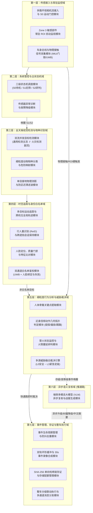

# 智能汽车露营守卫系统：模块划分与工程实施方案

> **文档定位**：本文档面向系统架构师、算法工程师、嵌入式软件工程师及测试团队，将《智能汽车露营守卫算法流程》拆解为清晰的**工程模块划分、各模块职责边界、输入输出接口及协同运行机制**，作为代码开发、模块联调与系统集成的实施蓝图。

---

## 目录
1. [系统总体架构与分层设计](#一-系统总体架构与分层设计)
2. [七大业务域与核心模块详细划分](#二-七大业务域与核心模块详细划分)
   - 2.1 系统管控与状态机调度域
   - 2.2 基础感知与常驻轻量化监控域
   - 2.3 全天候视觉检测与物种识别域
   - 2.4 时空目标追踪与身份白名单域
   - 2.5 细粒度行为分析与多源威胁裁决域
   - 2.6 异步多模态语义复核域（慢通路）
   - 2.7 事件管理、安全存证与整车执行域
3. [模块间核心业务协同流转（三大典型场景走查）](#三-模块间核心业务协同流转三大典型场景走查)
4. [工程目录映射与配置解耦规范](#四-工程目录映射与配置解耦规范)

---

## 一、 系统总体架构与分层设计

露营守卫系统在工程上采用**“状态分级唤醒 + 快慢通路解耦 + 多源证据融合”**的分层架构。全系统由下至上划分为 **7 大业务域、22 个功能子模块**：

### 核心工程设计原则
1. **常驻通路与按需通路分离**：S0 运动检测与 Zone 3 敏感部件 ROI 监视采用纯 CPU 轻量算子常驻运行；深度神经网络模型常驻显存但仅在 S1/S2 状态按需调度推理，兼顾毫秒级唤醒与整夜瓦级低功耗。
2. **双流并发检测**：在 S1/S2 阶段，通用目标检测（人/车/动物）与火灾烟雾检测（火焰/浓烟）在独立工作线程与异步流中**同时运行**，单帧一次性补齐安防与消防感知。
3. **快通路即时响应、慢通路异步纠偏**：视觉规则与物理接触信号构成的“快通路”在毫秒级内立即触发录像与声光防御；多模态大模型（VLM）作为“慢通路”在后台独立线程运行（1~3 秒），负责生成中文简报并对纯视觉误报进行事后降级纠偏，绝不阻塞实时防线。

---

## 二、 七大业务域与核心模块详细划分

### 2.1 系统管控与状态机调度域

本域相当于系统的“总指挥部”，负责守卫模式的开启/关闭验证、S0/S1/S2 状态切换以及极端环境下的故障兜底。

#### 模块 1：系统激活、退出与车主验证模块
- **功能用途**：管控露营守卫的安全开启与防盗退出，防止非法越权解除守卫（如钥匙信号中继攻击）。
- **输入**：档位状态（P 档）、电子手刹（EPB）、中控/App 守卫开关、四门与后备箱锁状态、刹车踏板信号、解锁请求信号、UWB 钥匙空间坐标、座椅占位传感器信号。
- **输出**：系统激活状态（Active / Inactive）、当前工作模式（车内模式 / 车外模式 / 野外模式）、越权解锁 L3 告警指令。
- **实现要点**：
  1. **开启校验**：必须同时满足“P 档 + EPB 拉起 + 守卫开关开启 + 全车门锁闭”，缺一不可（车门未关好时向车主弹窗提示，严禁静默带病启动）。
  2. **工作模式自动识别**：根据“车内座椅占位 + UWB 钥匙在车内”自动判定为**车内模式**或**车外模式**；结合导航定位或用户开关开启**野外模式**。
  3. **安全退出校验**：踩刹车切出 P 档直接退出；若是外部解锁（蓝牙/App/实体钥匙），必须校验 UWB 钥匙是否在车旁 1.5 米内——若位置不匹配，判定为**疑似中继攻击/越权解锁**，拒绝退出守卫并立即拉响 L3 警报。

#### 模块 2：三级运行状态机调度模块 (`state_machine`)
- **功能用途**：根据车周态势在 S0（待机）、S1（初筛）、S2（研判）三个状态间动态流转，实现算力与功耗的按需分配。
- **输入**：S0 运动检测信号、Zone 3 ROI 扰动确认信号、车身接触硬触发信号、当前活跃目标列表（含所在防区与径向速度）。
- **输出**：当前运行状态（`S0_STANDBY` / `S1_SCREENING` / `S2_JUDGMENT`）及各阶段感知模块的启停控制掩码。
- **实现要点**：
  1. **常规逐级唤醒**：6m 内连续运动 ≥ 0.5s 触发 `S0 → S1`；目标进入 Zone 2（< 3m）、或朝车身径向逼近速度 > 0.8 m/s、或检出明火/烟雾触发 `S1 → S2`。
  2. **硬触发跳级唤醒**：收到车身震动/倾斜/玻璃破碎/门把手非法拉动，或 Zone 3 敏感部位 ROI 扰动多帧确认时，无论当前在 S0 还是 S1，**直接跳级拉起至 S2**。
  3. **冷却与逐级回落**：Zone 2/3 无目标且无接触事件持续 10s 回落 `S2 → S1`；车周无目标或仅白名单目标持续 15s 回落 `S1 → S0`；发生 L2/L3 事件后强制保持 S1 至少 60 秒冷却期，防止状态频繁乒乓抖动。

#### 模块 3：传感器异常诊断与故障降级模块
- **功能用途**：区分“人为恶意遮挡破坏相机”与“自然环境恶劣（暴雨/起雾）”，确保系统在硬件受限时不静默失效。
- **输入**：四路相机画面清晰度/亮度均值、Zone 3 多路 ROI 扰动面积占比、IMU 震动信号、NPU/GPU 推理心跳。
- **输出**：传感器健康状态、视野盲区提示、遮挡/篡改告警事件（L2/L3）、最小守卫降级指令。
- **实现要点**：
  1. **恶意遮挡告警**：单路相机画面全黑/纹理丧失持续 > 5s 触发 L2 告警；两路及以上同时被遮挡，或遮挡伴随车身震动，直接触发 L3 紧急告警。
  2. **全局环境异常过滤**：若四路相机的敏感 ROI 在同一时刻全部出现大面积扰动（如暴雨砸车、浓雾、狂风晃车），判定为全局环境干扰，不按“人为触车”处理，转入异常告警流程。
  3. **算力故障兜底**：若视觉推理引擎异常崩溃，自动降级为“S0 + IMU 震动 + 车门状态”的硬件最小守卫模式，并通知车主。

---

### 2.2 基础感知与常驻轻量化监控域

本域在 S0/S1/S2 全时段常驻运行，以极低的 CPU 开销完成车周运动初筛与车身极近距离接触兜底。

#### 模块 4：多路环视视频流接入与 S0 运动门控模块 (`video_source`)
- **功能用途**：统一管理前、后、左、右 4 路环视鱼眼/广角相机视频流，并在 S0 待机态下做低功耗运动侦测。
- **输入**：4 路相机原始硬件视频流。
- **输出**：带精确采集时间戳（毫秒）的标准化图像帧、Zone 1~3 地面投影区运动触发标志。
- **实现要点**：
  1. 屏蔽 6 米以外（Zone 0）画面区域，仅对 6 米内防区做背景建模运动检测。
  2. 结合连通域面积、持续时间与运动轨迹过滤飞虫、雨雪、树枝摇晃及已建模的营地静止物（帐篷、天幕摆动）。

#### 模块 5：Zone 3 车身敏感部件常驻 ROI 监视模块 (`zone3_daemon`)
- **功能用途**：专门解决“人员贴近车身（0~0.5m）时身体严重畸变或截断导致检测/姿态模型漏检”的痛点，对门把手、充电口、后备箱锁、车顶行李架等固定位置做全天候像素级扰动守卫。
- **输入**：各路相机低帧率画面（1~2 FPS）、预先标定的车身敏感部件多边形 ROI 像素坐标。
- **输出**：受扰动的敏感部位 ROI 列表（如 `handle_fl` 左前门把手、`charge_port` 充电口）、准硬触发唤醒 S2 信号。
- **实现要点**：
  1. **跨状态独立常驻**：作为独立守护通路，在 S0/S1/S2 均持续运行，不随主状态回落而关闭。
  2. **抗光影误报**：采用自适应背景建模（MOG2/ViBe）或光流强度而非简单帧差法，抑制云影、车灯扫过或自动曝光跳变；连续多帧（≥ 2~3 帧）超过前景比例阈值才确认为扰动事件。
  3. **联动闭环**：确认扰动后直接拉起 S2、锁定录像，并对该 ROI 外扩区域执行人体检测、姿态估计与大模型异步复核。

#### 模块 6：车身总线与物理接触信号采集模块 (`vehicle_bus`)
- **功能用途**：实时监听 CAN/以太网总线上的车身物理传感器信号，提供高可靠硬触发证据。
- **输入**：IMU 三轴加速度与倾角、门把手微动/电容触摸信号、车门/后备箱/引擎盖微动开关、充电枪拔插状态、声学玻璃破碎特征。
- **输出**：标准化的物理接触事件流（`ContactSensorEvent`：含事件类型、发生时间戳、信号强度）。

---

### 2.3 全天候视觉检测与物种识别域

本域在 S1/S2 状态激活，负责从图像中检出所有潜在威胁实体，并完成野生动物细粒度定性与物理距离解算。

#### 模块 7：双流并发目标检测模块 (`detector`)
- **功能用途**：对环视画面同时执行“通用目标检测”与“火灾烟雾检测”，单帧同步捕获人、车、动物与营地火情。
- **输入**：4 路相机图像帧（640×640）。
- **输出**：合并后的全类别检测框列表（含类别标签 `person` / `car` / `animal` / `fire` / `smoke`、像素包围盒、置信度）。
- **实现要点**：
  1. **双流并发执行（Parallel Ensemble）**：内部维护两个并发工作线程/异步 CUDA 流——**主流**运行通用/野生动物检测器，**副流**同步运行专用火灾烟雾检测器。两路在 GPU 上计算时间重叠，单次并发耗时仅取决于较长一方（约 7ms），无串行累加延迟。
  2. **框合并与人体优先原则**：通用检测与火灾检测类别互斥直接合并；若启用附加检测流，动物框与人体框 IoU > 0.5 时强制以“人体（person）”为准，防止蹲伏或弯腰的人员被误判为动物。

#### 模块 8：细粒度动物物种分类与危险映射模块 (`animal_classifier`)
- **功能用途**：解决通用检测器只能检出“是动物”但分不清是“松鼠/野兔”还是“棕熊/野猪/恶狼”的问题，实现野生动物分级防御。
- **输入**：检测模块输出的 `animal` 边界框及原图画面。
- **输出**：细粒度物种名称（中英文）、分类置信度、映射后的安全威胁类别（`大型猛兽` / `需关注动物` / `无害小型动物` / `未定性大型动物`）。
- **实现要点**：
  1. **三级防御流水线**：将动物框外扩 10%~20% 裁剪并缩放至 224×224 → 送入轻量分类网络输出 398 类动物概率 → 查表映射至安全等级。
  2. **轨迹级多帧投票聚合**：不对单帧低质量裁剪妄下结论，对同一动物轨迹保留高质量切片（面积大、未截断）做多帧投票，累计 ≥ 3 帧一致且平均置信度 ≥ 0.7 时正式“定性”。
  3. **物理体型兜底（防未知物种漏报）**：若分类置信度过低或物种不在库内，结合单目接地测距反推目标真实物理尺寸——**凡物理肩高 > 0.8m 或体积 > 0.4m³ 的未知动物，一律按“大型猛兽”触发 L2 预警**，并唤醒大模型语义复核。

#### 模块 9：单目接地物理测距与防区迟滞滤波模块 (`distance`)
- **功能用途**：将图像像素坐标转换为距车身外轮廓的真实水平物理距离（米），并稳定划分防区（Zone 0 ~ Zone 3）。
- **输入**：目标包围盒底部中心像素坐标（接地点）、相机内外参标定矩阵。
- **输出**：目标距车身水平物理距离（米）、径向逼近速度（m/s）、当前所属防区枚举。
- **实现要点**：
  1. **鱼眼逆投影（IPM）**：利用各相机安装高度、俯仰角与畸变参数，将目标接地点逆投影至以车体为中心的地面坐标系。
  2. **防区边界迟滞滤波（±0.3m）**：在 3.0m（Zone 1/2 边界）与 6.0m（Zone 0/1 边界）处设置 ±0.3m 迟滞带（例如从 Zone 1 进入 Zone 2 需 ≤ 2.7m，从 Zone 2 退回 Zone 1 需 ≥ 3.3m），彻底消除目标在防区边界走动时引发的报警与状态机高频振荡。
  3. **径向速度分解**：只提取朝向车身方向的径向速度分量，忽略切向路过（如车旁慢跑经过的路人）。

---

### 2.4 时空目标追踪与身份白名单域

本域负责把离散的单帧检测框串联成连续的时空轨迹，识别车主/同伴身份实现免打扰，并对绕车徘徊的陌生人保持跨机位锁死。

#### 模块 10：多目标运动追踪与跨机位全局轨迹模块 (`tracker` / `bytetrack`)
- **功能用途**：为每个移动实体分配唯一轨迹 ID，并在目标绕车跨越多颗摄像头视野时维持全局身份与累计滞留时长。
- **输入**：当前帧检测框集合、地面投影物理坐标、时间戳。
- **输出**：活跃追踪实体列表（`TrackedEntity`，含 `track_id`、累计滞留时间、运动轨迹历史）。
- **实现要点**：
  1. **10 秒短时离开累计机制**：同一目标短暂离开防区或被遮挡后，**10 秒内重新出现时滞留计时继续累加而非清零**，防止不法分子通过“进出防区边缘”刷掉计时器。
  2. **跨相机地面坐标交接**：当目标从左视相机边缘走向前视相机边缘时，基于统一地面坐标系下的“位置邻近度 + 时间窗”完成跨机位轨迹接力。

#### 模块 11：行人外观重识别 (ReID) 与跨遮挡会话保持模块 (`reid`)
- **功能用途**：当人员被帐篷、树木遮挡较长时间或跨摄像头交接存在歧义时，通过衣物/体型外观特征找回原身份（`PersonSession`）。
- **输入**：人体裁剪图像（256×128）、局部轨迹坐标与时间戳。
- **输出**：512 维归一化外观特征向量、绑定的全局人员会话 ID（`person_session_id`）、滞留时间上下界区间。
- **实现要点**：
  1. **事件触发式提取（非逐帧运行）**：仅在目标首次稳定建档、跨相机交接歧义、遮挡丢轨后重现、白名单重验 4 个时刻触发推理，平时零算力开销。
  2. **滞留时间上下界管理**：宁可拆开也不强行错误合并；将滞留时间维护为“[下界：已确认同一人累计时长，上界：含存疑交接累计时长]”，下界达标才直接升级告警，仅上界达标则提高取证关注度。

#### 模块 12：人脸定位、质量门禁 (FQA) 与特征比对模块 (`faceid`)
- **功能用途**：当人员靠近车身（≤ 2m）且面向车辆时，完成人脸捕获、图像质检与 512 维特征底库比对。
- **输入**：人体上半身裁剪区域、本地车主/同行营友授权人脸特征底库。
- **输出**：人脸识别状态（`VERIFIED` 已确认白名单 / `NO_MATCH` 陌生人 / `UNAVAILABLE` 质量不达标）、匹配人员姓名及余弦相似度。
- **实现要点**：
  1. **FQA 人脸质量门禁**：在提取特征前，先校验人脸像素尺寸（如 ≥ 40px）、拉普拉斯清晰度方差及左右偏航角对称比（过滤大侧脸与模糊残影），不合格者直接拦截，既省算力又防底库误匹配。
  2. **5 点对齐与特征比对**：通过 5 个面部基准点做仿射变换对齐至 112×112，提取 512 维特征向量与底库计算余弦相似度，多帧连续命中后锁定白名单状态。

#### 模块 13：双通道白名单身份鉴权管理模块 (`whitelist`)
- **功能用途**：融合 UWB 数字钥匙与人脸识别双通道结果，实现车主及同伴在营地活动时的“零误报免打扰”，同时严防陌生人“尾随借用”白名单身份。
- **输入**：UWB 钥匙空间坐标与鉴权状态、人体接地坐标、人脸比对结果、轨迹追踪状态。
- **输出**：目标白名单属性标志（`is_whitelisted`）。
- **实现要点**：
  1. **通道 A（UWB 空间对齐）**：UWB 钥匙距某人体接地点 ≤ 1.2m 且周围无其他候选人时，直接认定为车主；若 1.2m 内多人同处（如车主与陌生人擦肩），不单独用 UWB 放行，需结合通道 B（人脸）确认。
  2. **通道 B（人脸识别）**：作为近身免打扰与多人区分依据；无近红外活体硬件时，人脸通道不作为车门解锁依据，仅用于守卫告警豁免。
  3. **身份绑定与强制失效重验**：白名单身份与 `track_id` 绑定；一旦发生**轨迹遮挡丢失 > 3 秒、ID 跳变或多人轨迹交叉合并**，白名单标记立即失效并强制重新验证，杜绝不法分子趁车主进帐篷后“顶替”轨迹。

---

### 2.5 细粒度行为分析与多源威胁裁决域

本域在 S2 深度研判状态下工作，负责看清近身人员的每一个危险动作，并结合接触信号做出最终的威胁定级（L0~L3）。

#### 模块 14：人体骨骼关键点提取模块 (`pose_estimator`)
- **功能用途**：对进入 Zone 2/3 的陌生人员或敏感 ROI 扰动区域提取高精度人体骨骼关键点。
- **输入**：人体检测框裁剪画面（256×192）。
- **输出**：标准 17 个骨骼关键点像素坐标与置信度（鼻、双眼、双耳、双肩、双肘、双腕、双髋、双膝、双踝）。

#### 模块 15：近身违规动作几何拓扑判定模块 (`pose_action`)
- **功能用途**：基于 17 个骨骼关键点的空间位置与时序运动轨迹，识别徘徊、贴窗窥探、拉门撬锁、蓄意踢踹、盗窃车顶/后备箱装备等行为，并输出**视觉证据置信分级（中置信 / 高置信）**。
- **输入**：连续多帧人体关键点序列、车窗/门把手/充电口/行李架等标定 ROI 坐标、时间戳。
- **输出**：细粒度动作类型（`ActionType`）、视觉证据等级（中置信 / 高置信）、行为描述文本。
- **实现要点**：
  1. **关键点质量门控**：参与判定的核心关键点（手腕、足踝、头部）平均置信度须 ≥ 0.5 且有效帧占比 ≥ 70%；若因严重遮挡缺失，最高只输出“中置信”。
  2. **四类核心高危动作拓扑规则**：
     - **贴窗窥探**：头部关键点距车窗 ROI ≤ 0.5m 且朝向车内，持续 ≥ 3.0s（→ 中置信 L2）。
     - **拉门撬锁**：手腕关键点进入门把手 ROI（约 25cm）内持续 ≥ 0.8s 为**中置信**；持续 ≥ 1.5s 且手腕出现 ≥ 2 次往复拉动振荡特征为**高置信**。
     - **蓄意踢踹**：足踝关键点在 Zone 3 内出现朝向车身的快速摆动（角速度远高于正常步行）1 次为**中置信**；5 秒内出现 ≥ 2 次踢击为**高置信**。
     - **装备盗窃**：手腕在车顶行李架/自行车架/充电口 ROI 内持续停留 ≥ 1.0s 为**中置信**；持续 ≥ 2.0s 且有拆取位移特征为**高置信**。

#### 模块 16：营火状态监控与火情蔓延研判模块 (`fire_monitor`)
- **功能用途**：区分“正常受控的露营篝火/卡式炉”与“无人看管火源”或“失控蔓延火灾”，避免车主做饭生火时频繁误报警，同时死守火灾底线。
- **输入**：火灾检测副流输出的 `fire` / `smoke` 边界框、地面距离、场内是否有白名单人员活动。
- **输出**：火情威胁等级（L0 / L2 / L3）及火势状态描述。
- **实现要点**：
  1. **稳定营火免扰（L0）**：火源位于 Zone 2 以外、面积稳定不扩张且有白名单人员在场看管 → 静默记录。
  2. **无人看管提醒（L2）**：稳定火源周围无人在场持续超过 **5 分钟** → 触发 L2 预警提醒车主注意用火安全。
  3. **失控火情告警（L3）**：火焰像素面积持续快速增大且逼近进入 Zone 2（距车 < 3m），或浓烟持续扑向车身 → 立即判定为失控火情，触发最高级 L3 撤离告警。

#### 模块 17：多源威胁融合裁决引擎 (`fusion`)
- **功能用途**：汇总视觉行为证据、野生动物等级、火情状态、车身物理接触信号与传感器异常，按统一规则裁决出当前最高威胁等级（`L0_SAFE` ~ `L3_CRITICAL`）。
- **输入**：追踪实体列表（含防区、滞留时间、物种等级、动作类型与视觉置信度）、物理接触事件列表、ROI 扰动状态、火情状态。
- **输出**：综合威胁等级（L0 / L1 / L2 / L3）、触发主因描述、是否带物理接触硬信号支撑标志（`has_contact_signal`）。
- **实现要点**：
  1. **视觉独立升 L3 能力**：当拉门撬锁、踢踹、装备盗窃达到**视觉高置信**，或大型猛兽以 > 1.2 m/s 径向冲刺进入 Zone 2（持续 ≥ 0.5s 且 ≥ 3 帧）时，**无需等待接触传感器信号，直接裁决为 L3**。
  2. **接触信号加速与锁定**：当视觉仅为**中置信**时，若在 **±2 秒时间窗内**收到门把手拉动、IMU 震动峰值或车身状态变化信号，**立即联合升级为 L3**，并打上“物理接触锁定”标签（禁止后续被大模型降级）。

---

### 2.6 异步多模态语义复核域（慢通路）

#### 模块 18：端侧多模态大模型 (VLM) 异步复核与战报生成模块 (`vlm_reviewer`)
- **功能用途**：作为后台异步运行的“AI 安全专家”，对复杂长尾场景做深度语义理解，对纯视觉误报做降级纠偏，对中置信度事件做升级确认，并为车主生成简明扼要的中文战报。
- **输入**：事件关键帧切片（1~3 张）、快通路初步判定上下文（目标类别、防区、触发原因）。
- **输出**：结构化复核结论（确认/否定、恶意行为类别、置信度）+ **50 字以内中文情况总结**（如：“发现一名穿深色连帽卫衣的人员正持续拉动左前门把手”）。
- **实现要点**：
  1. **严格唤醒门控**：仅在 (a) 检出未知障碍物或未定性动物、(b) 快通路已触发 L2/L3 需生成车主战报、(c) 视觉中置信且无接触信号的疑似盗窃/破坏需复核、(d) Zone 3 ROI 扰动需定性 四种情况下唤醒。
  2. **单实例异步队列**：运行在独立后台工作线程，同一时刻最多执行 1 个推理任务，同一事件的多次请求自动合并，绝不阻塞快通路的实时检测与报警响应。
  3. **升降级权限红线**：
     - **可升级**：对视觉中置信事件，若大模型高置信确认为恶意破坏 → 升级至 L3；
     - **可降级纯视觉事件**：对无物理接触信号支撑的纯视觉 L2/L3 事件，若大模型高置信判定为误报（如树影晃动、同伴正常拿取物品）→ 降级并停止声光动作，追加“已复核降级”通知；
     - **严禁降级接触事件**：凡带有物理接触信号（震动、拉门、玻璃破碎）支撑的事件，大模型仅生成文字描述，**无权降级**。

---

### 2.7 事件管理、安全存证与整车执行域

本域负责把裁决出的威胁转化为实际的车辆防御动作、30 秒完整视频证据以及发往车主手机的报警卡片。

#### 模块 19：事件生命周期管理与防抖去重模块
- **功能用途**：管理威胁事件从创建、锁定、冷却到归档的全过程，防止同一目标持续逗留时向车主手机疯狂刷屏推送。
- **输入**：多源融合裁决引擎输出的实时威胁结果、大模型异步复核回调。
- **输出**：标准化威胁事件记录对象（`ThreatEventRecord`）、触发推送指令、触发录像锁存指令。
- **实现要点**：
  1. **生命周期五态流转**：`INIT（创建分配唯一ID）` → `ACTIVE（多帧聚合累计）` → `LATCHED（达标锁定并触发首发推送与录像）` → `COOLING（60秒去重冷却）` → `FINALIZED（目标离开30s后封口归档）`。
  2. **60 秒同级去重与等级跃迁突破（Upgrade Bypass）**：同一目标/同一 ROI 在 60 秒内維持相同威胁等级时，仅静默更新事件持续时长，不重复弹窗；**一旦在冷却期内威胁等级发生跃升（如 L2 徘徊演变为 L3 拉门撬锁），立即突破冷却限制，强行触发 L3 最高优先级推送与声光驱逐**。

#### 模块 20：双轨环形缓冲与 30 秒事件录像合成模块 (`recorder` - 视频部)
- **功能用途**：确保每一次 L2/L3 威胁事件都能完整保存**“事发前 10 秒 + 事发后 20 秒”**共 30 秒的流畅视频证据，还原完整的事发前因后果。
- **输入**：实时相机图像流、事件触发时间戳。
- **输出**：恒定 30.0 FPS 的标准 MP4 视频文件（`{event_id}_{timestamp}.mp4`）及关键帧抓拍图。
- **实现要点**：
  1. **轻量 JPEG 内存环形缓冲**：常态下将最近 15 秒视频帧以 JPEG 压缩字节流保存在内存环形队列中，比存原始 RGB 矩阵节省 95% 以上内存，彻底杜绝内存溢出。
  2. **前 10s 回溯 + 后 20s 异步录制**：事件锁定瞬间，立即从环形队列切片提取前 10 秒画面，并在后台注册 20 秒持续收集任务，收集完毕后交由独立编码线程写入磁盘，不卡顿主线程。
  3. **恒定 30 FPS 时间戳重采样对齐**：针对 S0/S1/S2 帧率切换或偶发推理抖动，按每帧真实物理采集时间戳做等间距重采样对齐，彻底解决录像回放时“忽快忽慢/倍速失真”的问题。

#### 模块 21：SHA-256 单向哈希链存证与存储配额管理模块 (`recorder` - 存证部)
- **功能用途**：保护事件录像与日志不被覆盖、篡改或单条删除，并管理车机有限的磁盘空间。
- **输入**：合成完毕的 MP4 视频文件、事件完整上下文元数据、硬件授时源信号（GNSS 卫星授时 / NTP 网络授时 / 本地 RTC）。
- **输出**：只读锁定的存证视频、单向哈希链清单文件（`evidence_manifest.jsonl`）、单事件审计卡片 JSON、磁盘水位告警。
- **实现要点**：
  1. **单向哈希链完整性保护**：计算 MP4 文件的二进制 SHA-256 校验和，将其与事件 ID、授时时间戳、目标画像、行为描述及**上一条事件的区块哈希（`prev_hash`）**打包，按字典序序列化后计算当前区块 `block_hash`。任何事后替换视频文件或删改某条记录的行为都会导致哈希链校验断裂。
  2. **分级锁存与高水位淘汰策略**：
     - 普通巡检缓存循环覆盖；L2/L3 事件录像加盖只读保护锁（`LOCKED`）；
     - 专用存储分区达 **80% 水位**时通知车主导出清理；达 **90% 水位**时按“时间最久远 → 等级较低（优先释放已备份的 L2 录像，死保 L3 高危录像）”策略自动修剪。

#### 模块 22：整车分级联动执行与多通道消息分发模块 (`actuator`)
- **功能用途**：根据当前工作模式（车内有人 / 车外无人）与威胁等级（L1~L3），驱动整车灯光、音响、座椅震动及手机 App 做出恰当的分级防御响应。
- **输入**：威胁事件记录、当前工作模式、大模型复核更新通知。
- **输出**：车身控制总线指令（车灯、喇叭、座椅、中控屏）、发往手机 App / 云端 TSP 的标准 JSON 推送报文与可视审计卡片。
- **实现要点**：
  1. **车内模式 vs 车外模式差异化响应**：
     - **L2 预警**：车内模式下锁存录像 + App 静默通知（中控屏可选最低亮度显示外景，默认不亮屏防暴露车内有人）；车外模式下锁存录像 + App 图文推送 + 车底照地灯微光震慑。
     - **L3 紧急**：车内模式下**主驾座椅脉冲震动唤醒车主** + App 强提醒（若车主 30s 未响应或接触持续，自动升级车外声光驱逐）；车外模式下**大灯高频爆闪 3 次 + 车外扬声器播放警示音** + App 全屏强提醒。
     - **火情 L3 特殊规则**：全力唤醒车内乘员撤离 + 车外持续声光报警，严禁执行“驱逐”逻辑。
  2. **先响应、后纠偏机制**：快通路一旦判定 L3 立即执行声光/震动动作；若 1~2 秒后大模型异步复核高置信判定为纯视觉误报，立即下发终止指令停止持续性声光动作，并向车主补发“已复核降级”说明。

---

## 三、 模块间核心业务协同流转（三大典型场景走查）

为了让开发团队直观理解上述 22 个模块如何配合，以下展示三个最具代表性的真实场景走查：

### 场景 1：夜间陌生人靠近并尝试拉动车门把手（S0 → S1 → S2 → L3 闭环）
1. **运动唤醒**：陌生人走入距车 5 米处 → **【模块 4 运动门控】**连续 0.5s 检出运动 → 通知**【模块 2 状态机】**从 `S0` 切换至 `S1`。
2. **初筛与追踪**：**【模块 7 双流检测】**检出 `person` → **【模块 9 测距】**算出距车 4.5m（属 Zone 1） → **【模块 10 追踪】**分配 `Track #12` 并开始计时 → **【模块 13 白名单】**核验无 UWB 钥匙匹配，标记为陌生人（此时为 L1 仅记录）。
3. **逼近升级**：`Track #12` 走向左前门，距离缩近至 2.2m（越过 2.7m 迟滞线进入 Zone 2） → **【模块 2 状态机】**切换至 `S2 深度研判`。
4. **姿态与接触联合裁决**：
   - `Track #12` 伸手拉左前门把手 → **【模块 5 Zone 3 ROI】**检出左前把手区域扰动，同时**【模块 14 姿态提取】**与**【模块 15 动作判定】**识别出手腕关键点进入左前把手 ROI 持续 1.2s（视觉中置信）；
   - 同一瞬间，**【模块 6 总线采集】**捕获到左前门把手微动拉动信号；
   - **【模块 17 融合裁决引擎】**将“视觉中置信 + 把手拉动信号（±2s 内）”联合裁决为 **L3 紧急威胁（拉门撬锁）**，并标记物理接触锁定。
5. **存证与联动响应**：
   - **【模块 19 事件管理】**生成事件 `EVT_...`，触发**【模块 22 整车执行】**（车内模式下脉冲震动座椅唤醒车主 + App 强推；车外模式下大灯爆闪 3 次 + 语音警告）；
   - **【模块 20 录像合成】**立即从环形缓冲抽取前 10 秒画面，并继续录制后 20 秒，重采样为 30 FPS MP4 后交由**【模块 21 哈希存证】**计算 SHA-256 上链锁死；
   - 同时**【模块 18 VLM 复核】**在后台花 1.3 秒生成中文说明：“一名穿深色卫衣人员正尝试拉动左前门把手”，增量更新至车主 App 卡片。

---

### 场景 2：车主夜间从帐篷走回车旁拿东西（白名单无感放行）
1. 车主走入 4 米范围唤醒 `S1`，**【模块 7】**检出 `person`，**【模块 9】**算出接地点坐标 $(x, y)$。
2. **【模块 13 白名单模块】**比对发现车载 UWB 钥匙坐标与该人体接地点距离仅 0.4m（≤ 1.2m），且车周无其他人员，立即将 `Track #01` 绑定为**白名单车主**（若走到 2 米内面向车门，**【模块 12 人脸模块】**同步完成人脸双重确认）。
3. **【模块 17 融合裁决】**对白名单目标直接定级为 **L0 安全**，豁免一切声光报警与弹窗推送，仅静默写入日常日志；车主离开 15 秒后系统平滑退回 `S0`。

---

### 场景 3：野外露营篝火无人看管 + 森林狼靠近（双流并发与物种分级）
1. **双流同步感知**：在 `S1` 状态下，**【模块 7 双流并发检测】**的主流检出距车 4.8m 处有一只动物（`animal`），同时副流检出距车 4.2m 处有一团篝火（`fire`）。
2. **动物支线**：动物切片送入**【模块 8 物种分类】**，连续 3 帧高置信识别为“森林狼（timber wolf）”，查表映射为**“大型猛兽”** → **【模块 17 融合裁决】**立即触发 **L2 预警**（若森林狼以 > 1.2 m/s 朝车冲刺进入 3 米内，立即升至 **L3 紧急告警**）。
3. **营火支线**：**【模块 16 火情监控】**跟踪该篝火框，发现面积稳定，但白名单车主已进车睡觉（车外无人在场持续满 5 分钟） → 自动触发一条 **L2 无人看管火源提醒**推送至车主手机，提醒确认营火是否已妥善熄灭。

---

## 四、 工程目录映射与配置解耦规范

在工程代码实现中，各功能模块与源码目录严格保持一对一映射，同时将所有硬件标定与模型路径抽离为独立配置文件，确保跨车型移植与模型升级时无需修改业务代码：

| 业务域 | 工程源码路径 (`camping_guard/`) | 对应的核心类 / 模块 |
| :--- | :--- | :--- |
| **系统配置与数据结构** | `config.py` / `types.py` / `vehicle_calib.json` | `GuardConfig`, `VehicleCalibration`, `TrackedEntity`, `ThreatEventRecord` |
| **状态机与常驻守护** | `state_machine.py` / `zone3_daemon.py` | `GuardStateMachine`, `Zone3ResidentDaemon` |
| **视觉检测与物种分类** | `perception/detector.py` / `animal_classifier.py` | `ParallelEnsembleDetector` (双流并发), `AnimalClassifier` |
| **几何测距与时空追踪** | `perception/distance.py` / `bytetrack.py` / `tracker.py` | `GroundDistanceEstimator`, `ZoneHysteresisFilter`, `ByteTracker`, `TargetTrackManager` |
| **身份鉴权与重识别** | `perception/faceid.py` / `reid.py` / `whitelist.py` | `FaceIDPipeline`, `FaceQualityAssessor`, `OSNetReIDExtractor`, `WhitelistManager` |
| **姿态与多源威胁裁决** | `perception/pose_estimator.py` / `analysis/pose_action.py` / `fire_monitor.py` / `fusion.py` | `RTMPoseEstimator`, `PoseActionClassifier`, `CampfireMonitor`, `MultiSourceFusionEngine` |
| **大模型异步慢通路** | `review/vlm_reviewer.py` | `AsyncVLMReviewer` |
| **存证录像与整车联动** | `evidence/recorder.py` / `vehicle/actuator.py` / `mock_bus.py` | `EvidenceRecorder`, `VehicleActuator`, `MockVehicleBus` |
| **顶层协同调度引擎** | `engine.py` / `profiler.py` | `CampingGuardEngine`, `PipelineProfiler` |
